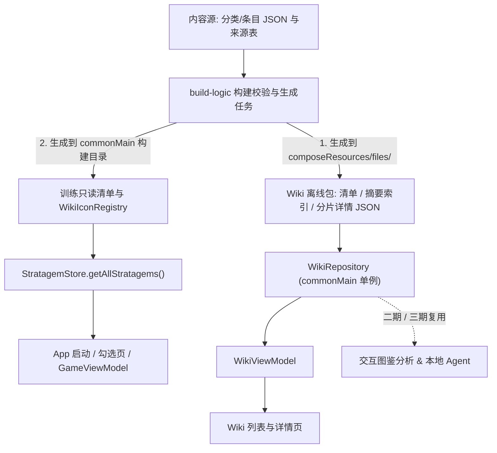

# Helldiver Trainer 游戏资料库（Wiki）设计方案

本文档面向 Android 与 Desktop（JVM）双端，规划如何在现有训练器中接入《Helldivers
2》离线游戏资料库，并为后续的敌人交互图鉴、本地 AI 问答和独立资料包更新留出统一底座。

---

## 1. 目标与分期路线图

核心原则： **一次录入，多处复用**。所有战备、武器、敌人的数据由同一份版本库 JSON 维护，构建期分别生成训练器清单和
Wiki 离线数据包；后续的交互图鉴与本地 AI 问答直接调用同一套共享仓库接口，不重复造轮子。

| 阶段                               | 核心交付                                                                                               | 明确边界（本期不做）                                                                   | 验收标志                                                                                                   |
|------------------------------------|--------------------------------------------------------------------------------------------------------|----------------------------------------------------------------------------------------|------------------------------------------------------------------------------------------------------------|
| **第一期：离线基础 Wiki**          | 战备库迁入单一 JSON 源；补齐 3 件武器 + 3 个敌人样本；资料库入口、搜索、分类筛选、详情页与返回状态管理 | 不做敌人图片热区点击；不做武器/部位伤害推算与自动推荐；不接本地 AI；不支持热更新数据包 | 离线可搜可看三类条目；点击战备卡只进详情；训练器原有勾选与出题逻辑完全不受影响                             |
| **第二期：敌人图鉴与对位分析**     | 多视角可点击部位图、破甲前后预览、武器多分量伤害/穿甲规则推算、实测冲突仲裁、按目的分组的配装推荐      | 不做在线同步与本地 AI 自由对话                                                         | 点图片部位或列表项联动高亮；切“破甲后”自动切换到暴露组织并刷新推荐；不同补丁或冲突记录不误出确定结论       |
| **第三期：本地 Agent 问答**        | 接入现有 `Llamatik` 本地模型，应用侧先查共享仓库生成卡片，再由模型做轻量解释并核验引用编号             | 不依赖 2B 小模型自行发起多轮 Tool Calling                                              | 同一战备手查与问答返回同一组方向键；问“机炮”能区分装备与战备；引用编号失效或模型不可用时自动降级为候选卡片 |
| **第四期（按需）：独立数据包更新** | 资料包与高清图鉴按需下载、版本兼容校验、原子切换与损坏回退                                             | —                                                                                      | 游戏大补丁后无需发版即可更新资料；更新失败自动回退到上一可用版本                                           |

---

## 2. 玩家体验与页面规则

### 2.1 典型使用场景

| 玩家操作                           | 首屏应该给出的结果                                                                       | 下一步动作                                               |
|------------------------------------|------------------------------------------------------------------------------------------|----------------------------------------------------------|
| 搜索 `500kg`                       | 命中“飞鹰”500KG 炸弹，卡片直接显示图标、分类与完整方向键 `↑ → ↓ ↓ ↓`                     | 点击卡片进入详情，查看解锁条件、冷却时间与出处           |
| 搜索 `机炮`                        | 同时列出“机炮（呼叫战备）”与“机炮（武器装备）”以及其他名称相近的条目，用类型标签明确区分 | 点开战备看呼叫指令，或点开武器看弹匣、穿甲与伤害         |
| 选“敌人”并按阵营筛选，点开某只敌人 | 展示识别信息、已收录部位与护甲/机制摘要、以及所属家族与变种                              | 点击查看某部位（如外甲 vs 内部暴露组织），或跳到相关变种 |
| 问“飞鹰空袭怎么按”（三期）         | 应用直接查出 ↑ → ↓ → 并渲染可点击战备卡片                                                | 点击卡片打开战备详情                                     |
| 问“两把解放者的弹匣差多少”（三期） | 名称有歧义时先让玩家勾选具体型号，再按相同配置与单位列出数值对比                         | 查看两侧原始字段值与核验补丁版本                         |

### 2.2 入口与页面布局

- **入口位置**：在现有主页增加“资料库”入口。注意当前 `MainFragment.kt` 把 4 个按钮放在无滚动的
  `Column` 中，新增按钮时需改用可垂直滚动容器以防手机横屏时内容被裁切（后续也可评估直接放入
  `MainContainer.kt` 的底部栏 / 侧边栏）。
- **资料库首页**：顶部搜索框 + 武器、敌人、战备三个分类入口。
- **详情页阅读顺序**：识别信息（中英文名、图标、类型/阵营） → 常查字段（如呼叫指令、冷却、基础属性） →
  说明与关联条目（如“呼叫的装备”“已收录变种”） → 资料来源与已核验补丁。关键字段未录入时统一显示
  **“待核验”**，绝不填 0。
- **战备卡片动作唯一**：在 Wiki 中点击战备卡片 **只打开详情页**，不触发训练器跳转或加入训练勾选，防止玩家误改训练池。
- **宽窄屏布局断点**：
    - **窄屏（宽度 `< 840dp`）**：采用“列表页 → 详情页”逐级跳转。
    - **宽屏（宽度 `≥ 840dp`，即 `ScreenAdapter.kt` 的 `WindowType.Expanded`）**：左侧显示搜索与列表，右侧并排显示当前详情。
    - **注意 Desktop 默认窗口**：当前 `main.kt` 的默认窗口为 `750.dp × 530.dp`（处于 `Medium` 档，
      `isTwoPaneCandidate()` 为 `true`）。750dp 宽同时塞下左侧列表、右侧详情（以及二期图鉴热区与部位面板）会过于拥挤，因此
      **Wiki 双栏模式只在宽度 `≥ 840dp` 时启用**（或同步调大 Desktop 默认窗口宽度）。

### 2.3 状态保留与跨平台返回链路

页面把 **查询状态**和 **详情浏览历史**分开保存，不因宽窄屏切换而丢失上下文：

1. **查询状态**：当前关键词、选中的大类（武器/敌人/战备）、附加筛选项（分类/槽位/阵营）、列表当前首个可见条目
   ID 与滚动像素偏移。
    - 修改关键词、切换大类或清除筛选后，列表回到顶部。
    - 切换大类时保留关键词，自动去掉不适用于新大类的筛选项；零命中时保留当前筛选条件并提供“清除筛选”按钮；主动清空关键词则显示当前分类全部目录。
2. **详情浏览历史（内部历史栈）**：保存按打开顺序排列的 `entryId` 列表，以及每条详情各自的滚动位置。
    - 在窄屏点击结果卡、或在宽屏右侧点击关联条目时，将新 `entryId` 压入历史栈。
    - 在宽屏点击左侧另一张搜索结果卡时，直接替换为新的起点栈；若点击关联条目正好回到历史栈中已打开过的某条，则直接退回到那一层，避免套娃死循环。
    - 在宽屏且右侧已打开详情时主动修改搜索词，清空旧详情历史，展示新搜索结果。
3. **统一的返回顺序（顶部返回按钮与系统返回键一致）**：
    - 先弹出详情历史栈的栈顶（例如：从“机炮武器详情”退回“机炮战备详情”，再退回“搜索结果列表”且恢复原滚动位置）。
    - 详情栈已空且当前处于分类列表或搜索结果页时，退回资料库首页。
    - 已在资料库首页时，退出资料库返回应用主页。
4. **跨平台实现约束与会话生命周期**：
    - `commonMain` 严禁直接引入 `androidx.activity.compose.BackHandler`。需采用 Compose Multiplatform
      自带的跨平台返回拦截 API（或通过 `bridge/` 下 `expect`/`actual` 封装），Desktop 端支持按 `Esc`
      触发同款返回逻辑。
    - 扩展 `SuperScaffoldTopBar.kt` 增加可选 `onBack: (() -> Unit)?` 回调，不再写死
      `navController.navigateUp()`。
    - **进入与退出生命周期**：`MainFragment.kt` 跳转其他页面时带有
      `popUpTo(MainContainer) { saveState = true }` 和 `restoreState = true`。Wiki **不**
      沿用该状态持久化——每次从主页点击“资料库”进入时创建全新的 `WikiViewModel`
      ，资料库内部跳转和返回全程保留状态，退出回主页后释放。

---

## 3. 内容模型与数据契约

### 3.1 核心实体

| 对象                  | 必填字段                                                                                                                                                                 | 可选字段与约束                                                                                                                                                                                                              |
|-----------------------|--------------------------------------------------------------------------------------------------------------------------------------------------------------------------|-----------------------------------------------------------------------------------------------------------------------------------------------------------------------------------------------------------------------------|
| **公共条目**          | `entryId`（全局稳定，如 `hd2.weapon.autocannon`）、`kind`（`weapon` / `enemy` / `stratagem`）、`nameZh`、`sourceId`、对应类型子对象                                      | `nameEn`、`summary`、`iconKey`、`aliases[]`（每项带 `locale` 与 `text`）、`verifiedPatch`。条目改名、换图时 `entryId` 永远不变                                                                                              |
| **战备子对象**        | `category`（7 类枚举：`eagle` / `orbital` / `support_weapon` / `backpack` / `vehicle` / `defensive` / `mission`）、`directions`（`UP` / `RIGHT` / `DOWN` / `LEFT` 序列） | `callInSeconds`、`cooldownSeconds`、`uses`、`unlockRequirement`、`training{legacyId, order}`。仅可训练战备携带 `training`，`order` 从 1 起按原全表顺序递增                                                                  |
| **武器子对象**        | `slot`（`primary` / `secondary` / `throwable`）、`weaponClass`（按槽位约束的二级子类）、`configurations[]`                                                               | 每套配置有唯一 `configId`（基础配置固定为 `base`），记录型号/弹种/配件、弹匣容量、射速、射击模式与 `attacks[]`（每个攻击模式有唯一 `attackId`、游戏内伤害与穿甲）。列表索引只收基础配置与已录入型号；支援武器仍归属战备目录 |
| **敌人子对象**        | `faction`、`sizeClass`（`small` / `medium` / `heavy` / `massive`）、`familyKey`、`parts[]`                                                                               | 每个部位有条目内唯一 `partId`、`nameZh`、护甲值与机制说明；`familyKey` 用于家族聚合；具体变种独立建条，通过 `variant_of` 指向基础型                                                                                         |
| **条目关系**          | `type`、`targetId`（起点为当前条目）                                                                                                                                     | 一期支持 `calls_in`（战备 → 武器）和 `variant_of`（敌人/武器变种 → 基础型）。禁止自指与成环；可覆盖 `sourceId` 与适用条件；反向链接由构建期自动生成                                                                         |
| **来源表（Sources）** | 唯一 `sourceId`、`title`、`sourceType`                                                                                                                                   | 迁移来源记录原代码位置与旧 ID；网页来源记录 URL、修订号或核验日期。游戏补丁版本单独记录，不拿代码迁移日期冒充游戏补丁                                                                                                       |

### 3.2 关键建模规则

1. **四态数值表达（区分“0”“无限”和“未知”）**：
    - 数值字段必须明确标注状态：`known`（必须带具体数值与显式单位，如 `cooldownSeconds`、`fireRateRpm`）、
      `unknown`（待核验，未填字段默认等价于此状态）、`not_applicable`（不适用，如无弹匣武器）；仅使用次数上限等字段允许
      `unlimited`（无限制）。
    - **筛选、排序与后续对比计算只采用 `known` 数据**，基础数值与舰船模块升级后的数值分开展示。
    - 同一条目内若个别字段来源不同或更新滞后，允许在字段级覆盖 `sourceId`、`verifiedPatch` 与
      `condition`；详情优先展示字段级来源，没有则继承条目默认来源。
2. **同名装备与战备拆条**：
    - 以“机炮”为例：`hd2.stratagem.autocannon` 保存呼叫指令与 `training.legacyId = "sw_4"`，并通过
      `calls_in` 指向 `hd2.weapon.autocannon`
      ；武器条目保存弹药、穿甲与伤害。详情页自动互链（“呼叫的装备” ↔ “对应战备”）。
3. **敌人变种的维护与隔离**：
    - 编辑源码中允许变种显式声明继承基础型并局部覆写（`extends` + `partOverrides`
      ），避免几十个变种把相同部位复制粘贴多遍；
    - **构建期会自动将继承关系展开为独立完整的部位列表**，确保运行时每个变种只展示自己已确认的数据，互不串台。

### 3.3 最小战备 JSON 示例

```json
{
  "entryId": "hd2.stratagem.eagle_airstrike",
  "kind": "stratagem",
  "nameZh": "“飞鹰”空袭",
  "nameEn": "Eagle Airstrike",
  "aliases": [{ "locale": "zh-CN", "text": "飞鹰空袭" }],
  "iconKey": "eagle_airstrike",
  "sourceId": "project_catalog_v1_8_0",
  "stratagem": {
    "category": "eagle",
    "directions": ["UP", "RIGHT", "DOWN", "RIGHT"],
    "cooldownSeconds": { "status": "unknown" },
    "training": { "legacyId": "eagle_3", "order": 3 }
  }
}
```

---

## 4. 现有战备库迁移方案

现有代码中有三处直接依赖 `StratagemStore.getAllStratagems()` 的同步返回值，迁移期间
**必须保持该同步入口签名与行为稳定**，不能让训练器和冷启动等待 Wiki JSON 异步读取：

| 现有调用点                               | 原有依赖逻辑                                                             | 迁移后的处理                                                                               |
|------------------------------------------|--------------------------------------------------------------------------|--------------------------------------------------------------------------------------------|
| `App.kt`（`InitLocalData`）              | 当本地已选战备集合为空时，读取全部战备 ID 作为默认全选                   | 继续同步读取由构建期生成的 Kotlin 只读清单；纯 Wiki 条目（无 `training` 对象）不进入该集合 |
| `StratagemSelectorPage.kt`               | 按全表顺序渲染勾选列表，以旧 `id` 作为列表键和持久化键                   | 保留原有 `legacyId`、顺序、图标和中文名；用户勾选结果继续按原键值对存盘                    |
| `GameViewModel.kt`（`initStratagems()`） | 普通模式取全量；自选模式按已选 ID 过滤，不足 10 项时循环补齐至至少 10 项 | 返回既有 `StratagemItem` 与 `StratagemInput` 类型；另需补充空集合兜底（见下）              |

### 现有战备数据核查与脏数据清理

对现有 `StratagemStore.kt` 逐条核对后的实际基线如下：

- 原代码共启用 **115** 条战备（飞鹰 8、轨道 12、支援武器 34、背包 14、载具 9、防守 19、任务
  19；“轨道照明曳光弹”已注释跳过）。
- **发现 1 组完全重复的脏数据**：`sw_1`（L258-263）与 `sw_6`（L288-293）名称均为 `“空爆火箭弹发射器”`
  ，图标均为 `MR.images.sw_airburst_rocket_launcher`，指令均为 `[DOWN, UP, UP, LEFT, RIGHT]`。
- **发现 1 组合法共用**：`ms_13`（上传数据）与 `ms_18`（将绝地喷射舱连接至驱逐舰）共用同一图标
  `ms_upload_data` 和同一指令 `[LEFT, RIGHT, UP, UP, UP]`，属于正常现象。

**拍板处理规则**：

1. **合并去重为 114 条有效战备**（支援武器由 34 条减为 33 条）：迁移时保留 `sw_1`，移除重复的 `sw_6`。
2. **老用户存档兼容与防崩溃保护**：
    - 在 `SharedKVManager.kt` 的 `getSelectedStratagemIDs()` 读取逻辑中增加一次轻量化映射：若旧存档包含
      `sw_6`，自动替换为 `sw_1` 并去重，防止老玩家只勾选了 `sw_6` 时更新后丢失选择。
    - 顺手修复 `GameViewModel.initStratagems()` 的潜在除零隐患：若过滤后 `storedStratagems.isEmpty()`
      ，自动回退为全部战备列表，避免 `ceil(10.0 / storedStratagems.size)` 抛出异常或崩溃。
3. **构建校验规则区分**：`entryId`、`training.legacyId`、`training.order` 必须全库唯一； **`iconKey` 与
   `directions` 允许跨条目复用**（保障 `ms_13` 与 `ms_18` 等正常共用情况能通过构建校验）。

---

## 5. 存储、构建与检索设计

### 5.1 单一数据源与双端产物

首期采用 **“仓库内 JSON 内容源（战备按 7 个分类文件、武器/敌人按条目文件维护） → 构建期校验生成 →
随包分发 + 内存索引”** 方案。先用真实条目实测加载耗时和内存，暂不引入 SQLite。



### 5.2 KMP 工程落地关键点

1. **资源读取与图标注册表**：
    - Wiki JSON 产物输出到 `composeApp` 的 `composeResources/files/` 目录下，在 `commonMain` 通过
      Compose Resources 的 `Res.readBytes(...)` + `kotlinx.serialization` 跨平台异步读取。
    - 战备图标继续复用现有的 `moko-resources`（`MR.images.*`）。构建生成任务同时输出一份 Kotlin 映射表
      `WikiIconRegistry`（`fun resolve(iconKey: String): ImageResource?`），直接引用 `MR.images` 常量。任何
      JSON 里拼错了 `iconKey`，会在校验阶段直接打断构建，彻底杜绝运行时找不到图标。
    - 后续武器或敌人大尺寸图鉴（如 1200×900） **禁止走 SVG**，统一使用 WebP 并约束单图分辨率与体积上限。
2. **构建插件与测试基础设施**：
    - 项目当前没有 `commonTest` 目录，也未在 `gradle/libs.versions.toml` 引入测试库。实施第一步前需补齐
      `commonTest` 与 `kotlin-test` / `kotlinx-coroutines-test`。
    - 校验逻辑（字段类型、关系防环、多边形合法性、来源引用）与代码生成逻辑体量较大，不适合堆在
      `composeApp/build.gradle.kts` 中。应在根工程抽离独立的 `build-logic`（或复合构建插件），显式声明输入/输出目录以兼容
      Gradle Configuration Cache 及当前 AGP 9.x（`androidKotlinMultiplatformLibrary`）任务图。
3. **何时才升级为 SQLite**：
    - 当内容扩充到数百个敌人及上千条交互/部位记录，在目标设备实测冷启动加载索引或搜索出现明显卡顿、峰值内存超预期时，再把
      `WikiRepository` 底层替换为预构建 SQLite，上层界面与 Agent 调用方无需改接口。

### 5.3 检索规范化与排序规则

- **文本规范化**：检索前统一做大小写折合、全角转半角、去多余空格、去掉连字符 `-`，并 **剥离中英文引号（
  `“”""`）与点号（`.`）**。这样搜 `AR23` 能命中 `AR-23`，搜 `飞鹰空袭` 能命中 `“飞鹰”空袭`，搜 `wasp` 或
  `sos` 也能直接命中 `StA-X3 W.A.S.P.发射器` 与 `S.O.S.求救信标`。
- **方向输入检索**：支持识别 `↑↓←→`、方向按键文字（`上下左右`）及 `WASD`（如 `wdsd`）。为避免玩家搜 `wasp`
  或 `sw` 时误判为方向序列，约定： **仅当查询词去除空格后全部由合法方向字符组成且长度 ≥ 3 时**
  才按方向序列检索（或直接在搜索栏旁提供方向小键盘快捷录入）。完全相同的方向序列允许返回多条结果（例如
  `ms_13` 与 `ms_18`）。
- **命中排序优先级**：
    1. 完整正式名或完整型号精确命中（基础型号排在同家族改型前面）；
    2. 经过核验的常用别名 / 俗称精确命中；
    3. 名称或型号前缀命中；
    4. 中文子串或方向连续子序列命中；
       同优先级按显示名与 `entryId` 稳定排序。

### 5.4 一期 `WikiRepository` 接口与并发保护

一期 `WikiRepository` 作为 Koin 单例注册在 `DataModule`，对外只提供 3 个只读操作：

| 接口                | 输入                                               | 返回与行为约定                                                                                             |
|---------------------|----------------------------------------------------|------------------------------------------------------------------------------------------------------------|
| `search(request)`   | 关键词 `text`、可选 `kind`、对应分类/槽位/阵营筛选 | 返回有序命中列表（含摘要、方向序列、图标键及命中原因），先过滤再打分排序；空关键词返回当前条件下的全部目录 |
| `getEntry(entryId)` | 稳定 `entryId`                                     | 按需加载对应类型的详情分片并缓存；索引不存在返回 `Missing`，索引有但详情缺失视为数据包损坏                 |
| `related(entryId)`  | 稳定 `entryId`                                     | 直接从内存索引读取正向与反向关系，返回关系类型、方向、目标摘要与适用条件                                   |

**并发与错误恢复**：

- 读取清单与分片失败区分 `ReadError`（I/O 或解析错误，界面保留列表并提供原位重试）与
  `UnsupportedVersion`（包格式过新/不兼容，给出明确提示）。
- 同一类型详情分片若同时被多个请求触发加载，只发起一次实际读取；读取失败的结果绝不写入成功缓存，确保下次重试能重新读取。
- `WikiViewModel` 内的搜索请求使用可取消的最新流（如 `flatMapLatest`
  ）或递增请求序号，快速改词或快速连点列表卡片时丢弃过期响应，只展示最后一次操作的结果。

---

## 6. 第一期实施步骤与验收标准

按以下 4 步顺序推进，每步验收通过后再进入下一步：

1. **补齐测试与构建底座，冻结战备迁移基线**：
    - 配置 `commonTest` 与测试依赖；搭建 `build-logic` 插件骨架。
    - 从当前 `StratagemStore.kt` 导出 115 条原始记录，清洗去重 `sw_6` → `sw_1` 后固化为独立的 **114
      条迁移对照基线**（供单测核对逐条一致，防止新生成器出现漏项、错序或错箭头）。
2. **切换战备数据源与兼容层**：
    - 按 7 个战备分类文件导入并生成 114 条战备源 JSON 与来源记录，接入构建校验（唯一性、`iconKey`
      合法性、方向合法性、所属分类文件一致性）。
    - 生成只读训练清单替换 `StratagemStore.kt` 手写列表；生成 `WikiIconRegistry`；在
      `SharedKVManager.kt` 补上 `sw_6 -> sw_1` 归一化，在 `GameViewModel.kt` 补上空列表兜底。
    - **验收**：运行单测校验新旧清单（除 `sw_6` 外）114 项逐条相等；覆盖“首次安装全选”“仅选 `sw_6`
      的旧存档迁移”“勾选不足 10 项循环补齐”三条测试路径。
3. **完成离线 Wiki 仓库与样本数据**：
    - 录入 3 件武器样本（含 `hd2.weapon.autocannon` 机炮，以及同家族两把如解放者基础型与变种）和 3
      个敌人样本（含一组基础型与变种 + 1 个其他阵营敌人），验证跨类关联与变种继承展开。
    - 实现 `WikiRepository` 并通过单测验证：`500kg` 命中飞鹰炸弹；`机炮` 同时返回战备与武器；`wasp`/
      `sos` 无引号点号能正常检索；未录入字段返回 `unknown` 而非 `0`；损坏分片重试可恢复。
4. **接入 UI 页面与双端验收**：
    - 实现资料库首页、分类/搜索列表页、详情页及 `NavRoute` 路由；对接 Android 窄屏（`< 840dp`）与 Desktop
      宽屏（`≥ 840dp`）双形态布局及跨平台系统返回。
    - **验收**：运行 Android 与 Desktop 编译及全部 `commonTest`
      ；人工走查三条核心链路——飞鹰详情与训练器箭头一致、机炮双向跳转与两次返回恢复列表原位、敌人阵营筛选与横竖屏/窗口缩放切换；全程断网且未加载
      AI 模型可顺畅完成。

---

## 7. 第二期：敌人交互图鉴与武器对位分析

本阶段在一期基础上，把敌人图鉴从“静态图文卡片”升级为“可点选部位、可预览破甲、可算武器效果与配装推荐”的交互工具。

### 7.1 统一部位主键与血池模型

二期以具体敌人变种的 **`entryId + partId`** 作为部位唯一主键（如强袭虫左前腿外甲
`left_front_leg_plate` 与甲下暴露组织 `left_front_leg_flesh`），一期已在敌人数据中预留好该稳定键。

| 模型位置                           | 核心字段                                                                                                                      | 说明                                                                                                  |
|------------------------------------|-------------------------------------------------------------------------------------------------------------------------------|-------------------------------------------------------------------------------------------------------|
| `EnemyAnatomy`（敌人详情扩展）     | `mainPool`、`parts[]`、`views[]`、`defaultViewId`                                                                             | 每个变种独立持有自己的解剖结构，图片资源可跨变种复用                                                  |
| `EnemyPart`（部位扩展）            | `partId`、`healthPoolRef`、`armor`、`durability`（0～1）、`toMainRatio`（可 > 1）、`explosionResistance`（0～1）、`onBreak[]` | 左右肢各自独立掉血时分配独立 `healthPoolRef`；未录 `onBreak` 时 UI 显示“破坏效果待核验”               |
| `onBreak`（破坏后果）              | `effectType`、目标 `partId` 或受限能力、`condition`、`sourceId`                                                               | 可表达“剥落外甲暴露内部部位”“失去某攻击能力”“进入流血延迟死亡”或“立即致死”                            |
| `WeaponAttack`（武器详情扩展）     | `weaponId`、`configId`、`attackId`、`components[]`                                                                            | 同一攻击模式可拆为多个伤害分量（如“直击弹头 + 范围爆炸”），分别记录普通伤害、耐久伤害、穿甲等级与来源 |
| `MatchEvidence`（独立事实表）      | 敌人部位键、武器攻击键、部位状态、命中条件、实测结论、来源与补丁                                                              | 专门收录爆炸重叠、主血池溢出、持续伤害等特殊实测例外，按双向索引挂接，避免两边重复维护                |
| `PartRecommendation`（独立推荐表） | 部位键、目的（如“破除外甲”“击杀”“限制能力”）、武器攻击键、适用条件、推荐理由与证据引用                                        | 先匹配目标部位、状态、配置与补丁，再按同组编辑序展示，不搞笼统的总评分                                |

### 7.2 归一化热区与点选交互

编辑者在底图上勾勒多边形热区，坐标按底图宽高归一化到 `0～1` 区间（左上角为原点），确保 Android 与 Desktop
共用同一份热区数据。

```json
{
  "viewId": "front",
  "assetKey": "charger_front",
  "assetRevision": "layout_1",
  "width": 1200,
  "height": 900,
  "regions": [
    {
      "regionId": "front_left_plate",
      "partId": "left_front_leg_plate",
      "polygon": [[0.62, 0.45], [0.73, 0.48], [0.69, 0.76], [0.60, 0.69]],
      "priority": 20,
      "visibleWhen": { "partId": "left_front_leg_plate", "state": "intact" }
    }
  ]
}
```

- **坐标逆变换与裁决**：计算触点时先扣除图片等比缩放的留白偏移，支持手势缩放/平移时同步逆变换触点，保证描边高亮与点击命中完全重合。多区域重叠时按
  `priority` 从高到低 → 多边形面积从小到大 → `regionId` 稳定裁决；点中空白保持当前选中不变。
- **跨视角与破甲预览**
  ：图片旁/下方提供可键盘聚焦与无障碍访问的部位列表（即使图片加载失败仍可点文字查看）。切换视角（如正面 →
  侧面）保留选中部位；点击“查看破甲后”时，根据 `onBreak` 隐藏外甲热区并激活内部组织热区与属性。

### 7.3 武器对位计算、冲突处理与推荐

1. **分分量规则推算**：输入 `敌人部位 + 部位状态 + 武器配置/攻击 + 游戏规则版本 + 命中条件`：
    - 保护层（外甲）未破时，直击内部组织直接提示“当前状态无法直接命中此部位”。
    - 对已知普通直击分量，根据当前补丁的穿甲/护甲阶梯判定“可穿透 / 等甲折减 / 跳弹无法穿透 /
      未知”；输入完备时按 `(1 - durability) × 普通伤害 + durability × 耐久伤害` 乘以护甲系数估算单发部位伤害，并显式标出
      **“规则推算”** 及所需前置条件（如未考虑距离衰减时明示缺项）。
    - 多分量攻击（如直击 + 爆炸）分别出结果（如“直击可破甲 / 爆炸效果待核验”），部分分量未知时不强行汇总“击杀发数”。
2. **实测与推算冲突处理**：同版本同条件下若实测记录与规则推算矛盾，双方标签并存展示差异，自动标记“待复核”，并从当前版本的自动推荐列表中剔除，防止误导玩家。
3. **推荐分组**：部位面板按玩家目的分组展示（如“破除外甲” vs
   “攻击暴露肉体”），严禁把外甲推荐套用到暴露组织上；有编辑实证的排在前面，其余按规则可造成伤害的武器归入“其他可用武器”。

### 7.4 二期扩展接口与构建校验

- **仓库扩展方法**（追加到 `WikiRepository`）：
    - `getAnatomy(enemyId)`：按需加载部位、视角、热区与血池数据（轻量搜索索引不加载几何与图片）。
    - `evaluateMatchup(context)`：返回各攻击分量判定、破坏后果、数据缺项及证据来源。
    - `recommendForPart(partRef, state, goal, patch)`：返回分组推荐列表与关联武器摘要。
- **页面状态扩展**：在原有详情历史节点上追加 `viewId`、`selectedPartId`、`previewState`、`goal` 与可选
  `attackRef`，从推荐卡点进武器详情再返回时原样恢复现场。
- **构建期补充校验**：检查所有热区多边形至少 3 个不重复顶点、面积大于 0、无自交、坐标均在 `[0, 1]` 内，且
  `assetRevision` 与所有部位/血池/证据引用有效。

---

## 8. 第三期：本地 Agent 问答接入

当前仓库已集成 `LlamatikLLMClient.kt`（默认模型 `LlamatikModels.Qwen35_2B`，`contextLength = 4096`，
`maxOutputTokens = 1024`，JSON Schema 通过 System Prompt 文本软约束）以及 `LlamatikTestViewModel.kt`
（目前发送 `tools = emptyList()`，Schema 仅为 `answer / keywords / found`）。

受限于端侧 2B 模型的推理稳定性与 4K 上下文上限，三期采用 **“应用侧先检索出卡 +
模型仅负责基于证据做短解释”** 的架构，不依赖模型自主发起 Tool Calling：

1. **应用侧直出与实体消歧**：
    - 应用先识别问题中的型号、别名、当前正在浏览的 `entryId` 以及高频意图（查指令、查属性、对比数值）。
    - 对于纯粹的“查方向键”“查某属性”“两把武器同配置数值对比”，直接调用 `WikiRepository`
      渲染结构化卡片，零幻觉且秒出。命中多条同名实体时，直接弹出实体选择胶囊让玩家点选。
2. **严格控制 Context 预算与防止思考死循环**：
    - 解释类问题从 `WikiRepository` 检索 **Top N（如 3～5 条）精简字段证据**，每条带上固定编号（如 `[E1]`
      ）、条目 ID、字段名、条件与补丁版本。
    - 多轮对话仅保留最近几轮必要指代摘要，给系统提示、证据文本和 1024 输出预留充足安全余量，避免挤爆
      4096 窗口或触发小模型重复思考。
3. **演进 Schema 与严格客户端验真（防幻觉）**：
    - 升级 `LlamatikTestViewModel.kt` 中的 `WIKI_JSON_SCHEMA`，除 `answer`、`found` 外增加
      `evidenceRefs: List<String>`（引用证据编号）与 `entryIds: List<String>`。
    - 客户端解析模型输出后，校验所有 `evidenceRefs`
      是否真实存在于本次注入的证据集合中；数值与方向键渲染一律以仓库原始字段为准，绝不信任模型手打的箭头或数字。
    - 一旦发生 JSON 解析失败、引用编号越界、模型未加载或生成异常，立刻
      **安全降级为展示应用侧检索到的候选条目卡片与原始字段**。
4. **详情页带上下文提问**：
    - 将 `NavRoute.kt` 中无参的 `LlamatikTestPage` 扩展为支持可选参数 `entryId: String? = null`
      ，让玩家在任意战备/武器/敌人详情页点击“问一问”即可带着当前条目进入对话，直接问“它的冷却时间是多少”或“用什么打这个部位”。

---

## 9. 内容维护、版权与第四期独立更新

1. **首批数据策略与版权合规**：
    - 战备先从本地 114 条完整迁出（中文名、图标、方向、分类立即齐备，英文名、冷却和解锁条件标为已知源待补录）。
    - 参考 [helldivers.wiki.gg](https://helldivers.wiki.gg/) 整理字段结构与数值，逐项登记来源 URL
      与核验日期/游戏补丁号。
    - **版权注意**：游戏文字描述尽量自行编写；若引用或搬运 wiki.gg 的文本或图片资源，必须在来源表及应用“关于/致谢”页按其要求（如
      CC BY-SA）逐项标注作者、原始链接与许可协议。
2. **补丁更新与发布门槛**：
    - 资料包版本号独立于游戏补丁号。每次游戏更新后，编辑者只修改受影响的条目并推进这些条目的
      `verifiedPatch`，未重新核验的条目保留原补丁标记。
    - CI / 本地构建必须卡死：ID 唯一、关系无环且目标存在、`iconKey` 在 `WikiIconRegistry`
      中存在、方向枚举合法、所有数值单位与状态合法、114 条迁移基线零差错。
3. **第四期独立资料包与热更新**：
    - 后续接入增量/全量资料包下载（以及高清敌人图鉴资源按需下载）时，先下载到临时目录，校验
      `schemaVersion` 兼容性、文件哈希完整性及内部引用一致性后，再原子替换生效包；任何一步失败均保留上一版有效资料包。玩家本地的收藏与训练勾选保存在
      `SharedKVManager`，与资料包版本完全解耦。

---

## 10. 参考页面

- [Helldivers Wiki 首页与分类](https://helldivers.wiki.gg/)
- [Stratagems 分类列表](https://helldivers.wiki.gg/wiki/Stratagems)
- [Eagle Airstrike 条目](https://helldivers.wiki.gg/wiki/Eagle_Airstrike)
- [AR-23 Liberator 条目](https://helldivers.wiki.gg/wiki/Liberator)
- [Charger 条目](https://helldivers.wiki.gg/wiki/Charger)
- [Damage 的可破坏护甲说明](https://helldivers.wiki.gg/wiki/Damage#Breakable_Armor_Plating)
- [Caustic Charger 敌人部位表](https://helldivers.wiki.gg/wiki/Caustic_Charger)
- [游戏伤害机制（Damage）](https://helldivers.wiki.gg/wiki/Damage)
- [穿甲提示说明（Getting Started）](https://helldivers.wiki.gg/wiki/Getting_Started)
