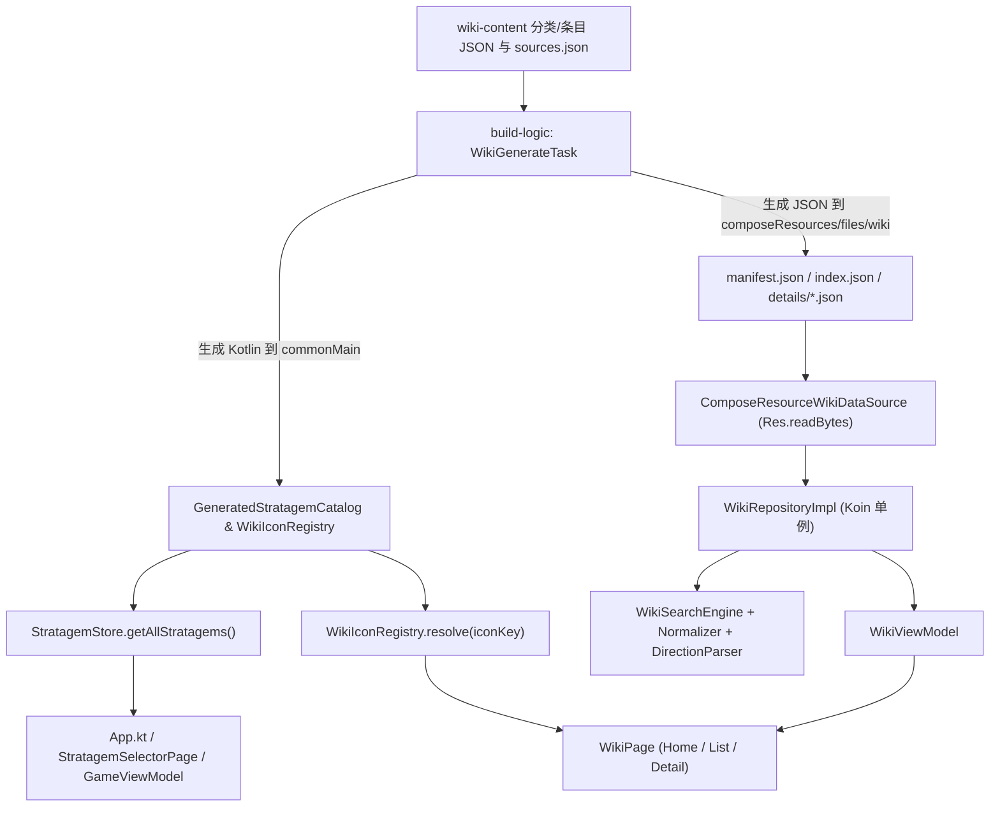

# Helldiver Trainer 游戏资料库第一期详细设计方案

本文档对应总方案 [wiki-design.md](./wiki-design.md) 中的 **第一期：离线基础 Wiki**，结合当前仓库代码（Kotlin
`2.4.21`、AGP `9.5.2` / `androidKotlinMultiplatformLibrary`、Compose Multiplatform `1.12.2`、Koin
`4.2.2`、`moko-resources` `0.27.1`、`kotlinx.serialization` `1.13.0`）给出可直接落地的工程设计。

---

## 1. 一期范围与交付清单

### 1.1 本期交付与明确边界

- **一期交付**：
    1. 搭建 `build-logic` 构建校验与代码生成插件，以及 `composeApp/src/commonTest` 单元测试基础设施。
    2. 将现有 `StratagemStore.kt` 中的战备清单迁入统一 JSON 数据源（去重 `sw_6 -> sw_1`，固化 **114**
       条战备与迁移对照基线），同时保持训练器同步入口与老用户存档完全兼容。
    3. 录入首批 **3 件武器** 与 **3 个敌人** 样本，验证跨类关系（`calls_in`）、同族改型（`variant_of`
       ）、变种继承展开（`extends` + `partOverrides`）与四态数值展示。
    4. 实现 `data/wiki` 离线仓库与检索引擎（规范化、方向反查、排序、分片按需缓存与失败重试）。
    5. 实现资料库首页、搜索/分类列表页、详情页，适配窄屏（`< 840dp`）与宽屏（`≥ 840dp`）布局及跨平台系统返回。
- **本期不做**：
    - 敌人交互图片热区、多视角切换与破甲预览（二期）。
    - 武器对部位伤害/穿甲推算引擎与配装推荐（二期）。
    - 本地 `Llamatik` AI 问答接入与路由传参（三期）。
    - 在线增量资料包热更新（四期）。
    - 一期仅在武器与敌人模型中 **预留** `configId`、`attackId`、`partId` 稳定键，保证二期平滑扩展而不改主键。

### 1.2 涉及文件与改造清单

| 类型             | 路径 / 模块                                                                              | 职责说明                                                                    |
|------------------|------------------------------------------------------------------------------------------|-----------------------------------------------------------------------------|
| 新增内容源       | `wiki-content/`                                                                          | 存放战备、武器、敌人原始 JSON 与 `sources.json`                             |
| 新增构建插件     | `build-logic/`                                                                           | 复合构建插件：校验内容源并生成 Kotlin 代码与离线 Wiki JSON 包               |
| 新增测试基础设施 | `gradle/libs.versions.toml`、`composeApp/build.gradle.kts`、`composeApp/src/commonTest/` | 引入 `kotlin-test`、`kotlinx-coroutines-test`，补充全套单元测试             |
| 新增平台桥接     | `composeApp/src/{commonMain,androidMain,desktopMain}/.../bridge/BackHandler.kt`          | 跨平台系统返回拦截（Android `BackHandler` / Desktop `Esc`）                 |
| 新增数据与检索层 | `composeApp/src/commonMain/.../data/wiki/`                                               | 序列化模型、数据源、文本规范化、方向解析、搜索引擎、仓库实现                |
| 新增状态管理     | `composeApp/src/commonMain/.../viewmodel/WikiViewModel.kt`                               | 查询状态、详情历史栈、并发防乱序、错误重试状态机                            |
| 新增 UI 页面     | `composeApp/src/commonMain/.../ui/wiki/`                                                 | `WikiPage`、`WikiHomePane`、`WikiListPane`、`WikiDetailPane` 与共享卡片组件 |
| 修改现有文件     | `settings.gradle.kts`、`composeApp/build.gradle.kts`                                     | 挂载 `includeBuild("build-logic")` 与生成任务/资源目录                      |
| 修改现有文件     | `StratagemStore.kt`、`SharedKVManager.kt`、`GameViewModel.kt`                            | 改为读取生成的只读清单；`sw_6` 存档归一化；空池防除零兜底                   |
| 修改现有文件     | `KoinModules.kt`、`NavRoute.kt`、`MainFragment.kt`、`SuperScaffoldTopBar.kt`             | 注册仓库与 ViewModel；新增 Wiki 路由、主页入口滚动与 `onBack` 回调          |

---

## 2. 目录结构与模块依赖

### 2.1 目标目录树

```text
Helldiver_Trainer/
├── build-logic/
│   ├── settings.gradle.kts
│   ├── build.gradle.kts
│   └── src/main/kotlin/cn/antares/helldiver_trainer/buildlogic/
│       ├── WikiGeneratePlugin.kt          # 注册任务并挂载到 Kotlin 编译与 Compose 资源生成
│       ├── WikiGenerateTask.kt            # @CacheableTask，兼容 Configuration Cache
│       ├── WikiValidator.kt               # 全量字段、关系防环、iconKey、基线规则校验
│       └── WikiGenerator.kt               # 生成 3 类产物（JSON 包、训练清单、图标注册表）
├── wiki-content/
│   ├── sources.json                       # 统一来源登记表
│   ├── stratagems/                        # 按 7 个战备分类拆文件（合计 114 条）
│   │   ├── eagle.json                     # 飞鹰（8）
│   │   ├── orbital.json                   # 轨道（12）
│   │   ├── support_weapon.json            # 支援武器（33，已合并 sw_6 -> sw_1）
│   │   ├── backpack.json                  # 背包（14）
│   │   ├── vehicle.json                   # 载具（9）
│   │   ├── defensive.json                 # 防守（19）
│   │   └── mission.json                   # 任务（19）
│   ├── weapons/                           # 武器（4层：weapons/<slot>/<weaponClass>.json）
│   │   ├── primary/assault_rifle.json
│   │   ├── secondary/melee.json
│   │   └── throwable/standard.json
│   └── enemies/                           # 敌人（4层：enemies/<faction>/<sizeClass>.json）
│       ├── terminid/small.json
│       ├── terminid/heavy.json
│       └── automaton/heavy.json
└── composeApp/
    ├── build/generated/wiki/kotlin/       # build-logic 生成 Kotlin 源码根目录（不入 Git）
    │   └── cn/antares/helldiver_trainer/wiki/generated/
    │       ├── GeneratedStratagemCatalog.kt
    │       └── WikiIconRegistry.kt
    └── src/
        ├── commonMain/
        │   ├── composeResources/files/wiki/ # 构建期生成，加入 .gitignore（避免覆盖默认资源集）
        │   │   ├── manifest.json
        │   │   ├── index.json
        │   │   └── details/
        │   │       ├── stratagem.json
        │   │       ├── weapon.json
        │   │       └── enemy.json
        │   └── kotlin/cn/antares/helldiver_trainer/
        │   ├── bridge/BackHandler.kt
        │   ├── data/wiki/
        │   │   ├── model/
        │   │   │   ├── WikiEnums.kt
        │   │   │   ├── WikiFact.kt
        │   │   │   ├── WikiSourceModels.kt
        │   │   │   ├── WikiPackModels.kt
        │   │   │   └── WikiResult.kt
        │   │   ├── datasource/
        │   │   │   ├── WikiPackDataSource.kt
        │   │   │   └── ComposeResourceWikiDataSource.kt
        │   │   ├── search/
        │   │   │   ├── WikiTextNormalizer.kt
        │   │   │   ├── WikiDirectionParser.kt
        │   │   │   └── WikiSearchEngine.kt
        │   │   └── repository/
        │   │       ├── WikiRepository.kt
        │   │       └── WikiRepositoryImpl.kt
        │   ├── viewmodel/
        │   │   └── WikiViewModel.kt
        │   └── ui/wiki/
        │       ├── WikiPage.kt
        │       ├── WikiHomePane.kt
        │       ├── WikiListPane.kt
        │       ├── WikiDetailPane.kt
        │       └── WikiComponents.kt
        ├── androidMain/kotlin/cn/antares/helldiver_trainer/bridge/BackHandler.android.kt
        ├── desktopMain/kotlin/cn/antares/helldiver_trainer/bridge/BackHandler.desktop.kt
        └── commonTest/
            └── kotlin/cn/antares/helldiver_trainer/wiki/
                ├── WikiNormalizerAndParserTest.kt
                ├── WikiSearchEngineTest.kt
                ├── WikiRepositoryTest.kt
                ├── WikiViewModelTest.kt
                └── SharedKVAndGameFallbackTest.kt
```

### 2.2 模块与调用依赖



---

## 3. 数据格式与 Kotlin 模型设计

### 3.1 内容源 Schema（`wiki-content/`）

#### （1）`sources.json`

```json
{
  "sources": [
    {
      "sourceId": "project_catalog_v1_8_0",
      "title": "Helldiver Trainer 既有战备清单",
      "sourceType": "project_migration",
      "location": "StratagemStore.kt@1.8.0",
      "url": null,
      "verifiedDate": "2026-11-23",
      "defaultPatch": null
    },
    {
      "sourceId": "wikigg_autocannon",
      "title": "Helldivers Wiki - AC-8 Autocannon",
      "sourceType": "wiki_gg",
      "location": "revision:2026-11",
      "url": "https://helldivers.wiki.gg/wiki/AC-8_Autocannon",
      "verifiedDate": "2026-11-20",
      "defaultPatch": "01.001.200"
    }
  ]
}
```

- 校验约束：`sourceId` 全局唯一；`sourceType` 一期枚举为 `project_migration`、`wiki_gg`、`patch_notes`、
  `official`。迁移日期不能自动填进 `defaultPatch`。

#### （2）四态数值 `WikiFact<T>` JSON 约定

数值类字段统一写成对象（未写该字段时由反序列化默认视为 `status = "unknown"`）：

```json
{ "status": "known", "value": 180.0, "unit": "seconds" }
{ "status": "unknown" }
{ "status": "not_applicable" }
{ "status": "unlimited" }
```

支持字段级覆盖来源、核验补丁与条件：

```json
{
  "status": "known",
  "value": 10,
  "unit": "rounds",
  "sourceId": "wikigg_autocannon",
  "verifiedPatch": "01.001.200",
  "condition": "双发弹夹装填"
}
```

#### （3）战备分类文件示例（`wiki-content/stratagems/eagle.json`）

战备按 7 个分类文件存放，每个文件顶层为 `{ "entries": [ ... ] }`；`build-logic` 在读取 `wiki-content/`
时同时支持多条目列表文件（战备）与单条目文件（武器/敌人）：

```json
{
  "entries": [
    {
      "entryId": "hd2.stratagem.eagle_airstrike",
      "kind": "stratagem",
      "nameZh": "“飞鹰”空袭",
      "nameEn": "Eagle Airstrike",
      "aliases": [
        { "locale": "zh-CN", "text": "飞鹰空袭" },
        { "locale": "en", "text": "Eagle Airstrike" }
      ],
      "summary": "向指定信标前方横向投下多枚高爆航弹。",
      "iconKey": "eagle_airstrike",
      "sourceId": "project_catalog_v1_8_0",
      "stratagem": {
        "category": "eagle",
        "directions": ["UP", "RIGHT", "DOWN", "RIGHT"],
        "callInSeconds": { "status": "unknown" },
        "cooldownSeconds": { "status": "unknown" },
        "uses": { "status": "unknown" },
        "unlockRequirement": null,
        "training": {
          "legacyId": "eagle_3",
          "order": 3
        }
      },
      "relations": []
    }
  ]
}
```

#### （4）武器分类文件示例（`wiki-content/weapons/primary/assault_rifle.json`）

武器按 `weapons/<slot>/<weaponClass>.json` 四层存放，顶层为 `{"entries": [...]}`；支援武器保留在
`stratagems/support_weapon.json`。一期在 `configurations[]` 下保留 `configId` 与 `attacks[].attackId`
，二期可直接挂伤害分量而不改主键：

```json
{
  "entries": [
    {
      "entryId": "hd2.weapon.liberator",
      "kind": "weapon",
      "nameZh": "AR-23 解放者",
      "nameEn": "AR-23 Liberator",
      "aliases": [
        { "locale": "zh-CN", "text": "解放者" },
        { "locale": "en", "text": "Liberator" }
      ],
      "summary": "超级地球标准制式突击步枪，综合性能均衡。",
      "sourceId": "wikigg_liberator",
      "verifiedPatch": "01.001.200",
      "weapon": {
        "slot": "primary",
        "weaponClass": "assault_rifle",
        "configurations": [
          {
            "configId": "base",
            "labelZh": "基础配置",
            "modelCode": "AR-23",
            "magazineCapacity": { "status": "known", "value": 45, "unit": "rounds" },
            "fireRateRpm": { "status": "known", "value": 640, "unit": "rpm" },
            "fireModes": ["半自动", "点射", "全自动"],
            "attacks": [
              {
                "attackId": "standard_bullet",
                "nameZh": "标准弹药",
                "damage": { "status": "known", "value": 70 },
                "armorPenetration": { "status": "known", "value": 2 }
              }
            ]
          }
        ]
      },
      "relations": []
    }
  ]
}
```

#### （5）敌人分类文件与变种继承示例（`wiki-content/enemies/<faction>/<sizeClass>.json`）

敌人按 `enemies/<faction>/<sizeClass>.json` 四层存放（`sizeClass` 固定为 `small` / `medium` /
`heavy` / `massive`），顶层为 `{"entries": [...]}`。基础型定义完整 `parts[]`；变种可写 `extends` +
`partOverrides`（ **构建期会将其展开为独立的完整 `parts[]`
，展开后从运行时结构中抹除继承细节，保证每个变种条目完全自包含**）：

```json
{
  "entries": [
    {
      "entryId": "hd2.enemy.charger_behemoth",
      "kind": "enemy",
      "nameZh": "巨兽强袭虫",
      "nameEn": "Charger Behemoth",
      "aliases": [{ "locale": "zh-CN", "text": "大强袭" }],
      "summary": "重装化强袭虫变种，头部与前腿覆盖更厚外甲。",
      "iconKey": "ic_terminid",
      "sourceId": "wikigg_charger_behemoth",
      "verifiedPatch": "01.001.200",
      "enemy": {
        "faction": "terminid",
        "sizeClass": "heavy",
        "familyKey": "charger",
        "extends": "hd2.enemy.charger",
        "partOverrides": [
          {
            "partId": "head",
            "nameZh": "头部甲壳",
            "armor": { "status": "known", "value": 4 },
            "notes": "生命值高于普通强袭虫，需更多反坦克火力击破。"
          }
        ]
      },
      "relations": [
        { "type": "variant_of", "targetId": "hd2.enemy.charger" }
      ]
    }
  ]
}
```

#### （6）一期首批录入样本清单

| 类型      | 拟录入条目                                                                                                                                                                                                         | 验证的机制                                                                                                        |
|-----------|--------------------------------------------------------------------------------------------------------------------------------------------------------------------------------------------------------------------|-------------------------------------------------------------------------------------------------------------------|
| 武器（4） | `hd2.weapon.liberator`（AR-23 解放者）、`hd2.weapon.liberator_penetrator`（AR-23P 穿甲解放者）、`hd2.weapon.stun_baton`（CQC-30 眩晕棍，副武器近战）、`hd2.weapon.g12_high_explosive`（G-12 高爆手雷，投掷物标准） | 覆盖主武器/副武器/投掷物四层分类；`AR-23` 型号精确命中且基础型号排在改型之前；`variant_of` 双向浏览；四态数值区分 |
| 敌人（4） | `hd2.enemy.scavenger`（食腐虫 / 小型）、`hd2.enemy.charger`（强袭虫 / 重型）、`hd2.enemy.charger_behemoth`（巨兽强袭虫 / 重型）、`hd2.enemy.hulk_bruiser`（浩劫屠夫 / 机器人重型）                                 | 阵营 × 体型四层筛选；`extends` + `partOverrides` 构建展开；`variant_of` 反向“已收录变种”；预留 `partId`           |

---

### 3.2 生成产物 Schema（`composeResources/files/wiki/`）

1. **`manifest.json`**：

```json
{
  "schemaVersion": 1,
  "packVersion": "1.0.0",
  "generatedFromAppVersion": "1.8.0",
  "entryCount": 120,
  "indexPath": "files/wiki/index.json",
  "detailPaths": {
    "stratagem": "files/wiki/details/stratagem.json",
    "weapon": "files/wiki/details/weapon.json",
    "enemy": "files/wiki/details/enemy.json"
  }
}
```

2. **`index.json`**：
    - 包含所有条目的轻量摘要（`entryId`、`kind`、`nameZh`、`nameEn`、`iconKey`、`category` / `slot` +
      `weaponClass` / `faction` + `sizeClass`、`modelCodes`、`directions`、构建期预计算的归一化字段
      `normalizedNameZh` / `normalizedNameEn` / `normalizedAliases` / `normalizedModelCodes`
      ）以及构建期双向展开后的关系列表 `relations`。
    - **设计意图**：搜索、分类筛选、列表卡片渲染以及相关条目列表展示 **只需读取一次 `index.json`
      即可全部完成**，无需加载任何详情分片。
3. **`details/{stratagem,weapon,enemy}.json`**：
    - 按 `kind` 分成 3 个文件；每个分片内含 `entries: Map<String, ...>`（按 `entryId` 索引）以及该分片实际引用到的
      `sources: Map<String, WikiSource>`（避免跨文件查找来源）。

---

### 3.3 核心 Kotlin 模型（`data/wiki/model/`）

```kotlin
@Serializable
enum class WikiKind {
    @SerialName("stratagem") STRATAGEM,
    @SerialName("weapon") WEAPON,
    @SerialName("enemy") ENEMY,
}

@Serializable
enum class WikiDirection { UP, RIGHT, DOWN, LEFT }

@Serializable
enum class StratagemCategory {
    @SerialName("eagle") EAGLE,
    @SerialName("orbital") ORBITAL,
    @SerialName("support_weapon") SUPPORT_WEAPON,
    @SerialName("backpack") BACKPACK,
    @SerialName("vehicle") VEHICLE,
    @SerialName("defensive") DEFENSIVE,
    @SerialName("mission") MISSION,
}

@Serializable
enum class WeaponClass {
    @SerialName("assault_rifle") ASSAULT_RIFLE,
    @SerialName("marksman_rifle") MARKSMAN_RIFLE,
    @SerialName("submachine_gun") SUBMACHINE_GUN,
    @SerialName("shotgun") SHOTGUN,
    @SerialName("explosive") EXPLOSIVE,
    @SerialName("energy_based") ENERGY_BASED,
    @SerialName("pistol") PISTOL,
    @SerialName("melee") MELEE,
    @SerialName("standard") STANDARD,
    @SerialName("special") SPECIAL,
}

@Serializable
enum class WeaponSlot {
    @SerialName("primary") PRIMARY,
    @SerialName("secondary") SECONDARY,
    @SerialName("throwable") THROWABLE,
}

@Serializable
enum class EnemyFaction {
    @SerialName("terminid") TERMINID,
    @SerialName("automaton") AUTOMATON,
    @SerialName("illuminate") ILLUMINATE,
}

@Serializable
enum class EnemySizeClass {
    @SerialName("small") SMALL,
    @SerialName("medium") MEDIUM,
    @SerialName("heavy") HEAVY,
    @SerialName("massive") MASSIVE,
}

@Serializable
enum class WikiFactStatus {
    @SerialName("known") KNOWN,
    @SerialName("unknown") UNKNOWN,
    @SerialName("not_applicable") NOT_APPLICABLE,
    @SerialName("unlimited") UNLIMITED,
}

@Serializable
data class WikiFact<T>(
    val status: WikiFactStatus = WikiFactStatus.UNKNOWN,
    val value: T? = null,
    val unit: String? = null,
    val sourceId: String? = null,
    val verifiedPatch: String? = null,
    val condition: String? = null,
) {
    companion object {
        fun <T> unknown(): WikiFact<T> = WikiFact(status = WikiFactStatus.UNKNOWN)
    }
}
```

仓库统一返回结果密封类：

```kotlin
sealed interface WikiResult<out T> {
    data class Success<T>(val data: T) : WikiResult<T>
    data class Missing(val entryId: String) : WikiResult<Nothing>
    data class ReadError(val message: String, val cause: Throwable? = null) : WikiResult<Nothing>
    data class UnsupportedVersion(val foundVersion: Int, val supportedVersion: Int) :
        WikiResult<Nothing>
}
```

---

## 4. 构建校验与代码生成（`build-logic`）

### 4.1 Gradle 复合构建与 Configuration Cache 兼容

`gradle.properties` 中已开启：

```properties
org.gradle.configuration-cache=true
org.gradle.caching=true
```

因此必须在 `settings.gradle.kts` 顶部 `pluginManagement` 块内挂载 `includeBuild("build-logic")`，并在
`WikiGenerateTask` 中严格遵守：

- 标记 `@CacheableTask`。
- 所有路径通过 `@InputDirectory`（`@PathSensitive(PathSensitivity.RELATIVE)`）、`@InputFile`、
  `@OutputDirectory` 属性声明。
- `@TaskAction` 内只读写声明好的 `DirectoryProperty` / `RegularFileProperty`， **不访问 `Project`
  实例**。

### 4.2 三类产物生成与 Compose Resources 挂载方式

`WikiGenerateTask` 一次执行分别输出以下三类产物：

1. **`build/generated/wiki/kotlin/.../GeneratedStratagemCatalog.kt`**：生成只读
   `List<GeneratedStratagemRecord>`（按 `training.order` 升序排列 114 条），直接引用 `MR.images.*` 和
   `StratagemInput.*`。
2. **`build/generated/wiki/kotlin/.../WikiIconRegistry.kt`**：
   ```kotlin
   object WikiIconRegistry {
       fun resolve(iconKey: String?): ImageResource? = when (iconKey) {
           "eagle_airstrike" -> MR.images.eagle_airstrike
           // ... 共 114 个战备图标 + 阵营/通用图标
           else -> null
       }
   }
   ```
3. **`composeResources/files/wiki/*.json`**：生成 `manifest.json`、`index.json` 和
   `details/{stratagem,weapon,enemy}.json`。

>
**重要避坑**：[composeApp/build.gradle.kts](file:///c:/Users/za244/Helldiver_Trainer/composeApp/build.gradle.kts)
目前已经使用默认目录 `composeApp/src/commonMain/composeResources/`（存放了 `ic_input_*.png`、
`ic_super_earth.webp`）。 **切勿调用 `compose.resources.customDirectory("commonMain", ...)`**
（它会覆盖默认目录导致现有图片丢失）。应直接把生成的资源目录追加到 `kotlin.sourceSets.commonMain`
对应的资源配置中（或在构建任务后输出/挂接到 `compose.resources` 允许的额外资源集，或者配置只同步到
`build/generated/wiki/composeResources` 并通过
`tasks.matching { it.name.contains("generateComposeResClass") || it.name.contains("copyNonXmlValueResources") || it.name.contains("prepareComposeResourcesTask") }`
建立显式任务依赖，或者直接作为 `Sync` 任务写入受 `.gitignore` 忽略的 `composeResources/files/wiki/`
目录）。为保证 AGP `9.5.2`（`androidKotlinMultiplatformLibrary`）与 Compose `1.12.2` 在双端稳定打包，
**推荐做法**：在 `composeApp/src/commonMain/composeResources/files/wiki/` 设为 `.gitignore` 忽略目录，由
`Sync` / `WikiGenerateTask` 直接生成到该路径，并让 `prepareComposeResourcesTaskForCommonMain`（或按任务名匹配
Compose 资源准备任务）`dependsOn(wikiGenerateTask)`；同时
`kotlin.sourceSets["commonMain"].kotlin.srcDir(generatedKotlinDir)` 并让 `compileKotlin*` 与 `ksp*`
（Ktorfit 使用 KSP）显式依赖该任务。

### 4.3 构建校验规则清单

构建校验器 `WikiValidator` 任一规则不通过即抛出 `GradleException`，统一报错格式为：
`[Wiki校验失败] 文件=<相对路径> entryId=<id> 字段=<field>: <具体原因>`

| 校验项           | 规则明细                                                                                                                                                                     |
|------------------|------------------------------------------------------------------------------------------------------------------------------------------------------------------------------|
| 必填与枚举       | `entryId`、`kind`、`nameZh`、`sourceId` 非空；枚举值必须合法；战备 `directions` 非空且元素只含 `UP/RIGHT/DOWN/LEFT`                                                          |
| 分类文件归属     | 位于 `stratagems/<category>.json` 内的每条记录，其 `kind` 必须为 `stratagem` 且 `stratagem.category` 必须与文件名一致（防放错文件）                                          |
| 唯一性约束       | `entryId` 全库唯一；`sourceId` 在 `sources.json` 内唯一；`training.legacyId` 与 `training.order` 全库唯一且 `order` 为正整数                                                 |
| 合法复用白名单   | **`iconKey` 与 `directions` 允许跨条目复用**（保障 `ms_13` 与 `ms_18` 正常共用 `ms_upload_data` 与 `LEFT, RIGHT, UP, UP, UP`，以及未来同名装备/战备复用图标）                |
| 引用完整性       | 所有条目与字段级 `sourceId` 必须在 `sources.json` 中存在；`relations[].targetId` 与 `enemy.extends` 目标必须存在                                                             |
| 图标存在性校验   | 若填写了非空 `iconKey`，必须在可映射的 `moko-resources/images/` 文件名集合中存在对应 `.svg`                                                                                  |
| 关系类型与防环   | `calls_in` 只允许 `stratagem -> weapon`；`variant_of` 只允许同 `kind` 指向（`enemy -> enemy` 或 `weapon -> weapon`）；禁止自指，并对 `variant_of` 与 `extends` 做 DFS 环检测 |
| 变种覆写合法性   | `enemy.partOverrides` 中的每个 `partId` 必须有效（存在于基础型或明确标记为新增部位）                                                                                         |
| 数值四态规范     | `status == KNOWN` 时 `value` 不得为 `null`；`UNKNOWN / NOT_APPLICABLE / UNLIMITED` 时 `value` 必须为 `null`；非负字段（冷却、弹匣、射速、护甲）`value >= 0`                  |
| 114 战备迁移保护 | 构建校验可对比战备数与 `training.order` 连续性（`1..114` 无空缺无重复），防止误删或插队破坏既有顺序                                                                          |

---

## 5. 现有训练器兼容与 `sw_6` 迁移方案

### 5.1 改造三处现有文件

1. **`StratagemStore.kt`**：删除 800 多行手写 `StratagemItem(...)`，委托给生成的只读清单：
   ```kotlin
   object StratagemStore {
       fun getAllStratagems(): List<StratagemItem> = GeneratedStratagemCatalog.items
   }
   ```
   返回类型 `List<GameViewModel.StratagemItem>`、方法签名与同步特性 **100% 不变**，因此 `App.kt`（L96）与
   `StratagemSelectorPage.kt`（L61）一行都不用改。

2. **`SharedKVManager.kt`**：在 `getSelectedStratagemIDs()` 读取时对历史脏 ID `sw_6` 自动归一化到
   `sw_1`：
   ```kotlin
   fun getSelectedStratagemIDs(): Set<String> {
       val raw = getSharedKVInstance().getStringOrNull(SELECTED_STRATAGEM_IDS)
       if (raw.isNullOrEmpty()) return emptySet()
       return raw.split(",")
           .asSequence()
           .filter { it.isNotBlank() }
           .map { if (it == "sw_6") "sw_1" else it }
           .toSet()
   }
   ```
   这样无论老用户之前只勾选了 `sw_6`，还是同时勾选了 `sw_1` 和 `sw_6`，迁移后都会平稳落入有效的 `sw_1`
   ，不会丢失训练配置。

3. **`GameViewModel.kt`（`initStratagems()`）**：补充过滤结果为空时的兜底保护：
   ```kotlin
   fun initStratagems() {
       allStratagems.clear()
       val catalog = StratagemStore.getAllStratagems()
       if (kvManager.isStratagemSelectMode()) {
           val selectedIDs = kvManager.getSelectedStratagemIDs()
           val storedStratagems = catalog.filter { selectedIDs.contains(it.id) }
           when {
               storedStratagems.isEmpty() -> allStratagems.addAll(catalog)
               storedStratagems.size < 10 -> {
                   val multiplier = ceil(10.0 / storedStratagems.size).toInt()
                   repeat(multiplier) { allStratagems.addAll(storedStratagems) }
               }
               else -> allStratagems.addAll(storedStratagems)
           }
       } else {
           allStratagems.addAll(catalog)
       }
   }
   ```

---

## 6. 离线数据层与检索引擎（`data/wiki`）

### 6.1 数据源抽象（便于单测注入）

```kotlin
interface WikiPackDataSource {
    suspend fun readBytes(relativePath: String): ByteArray
}
```

- 生产实现 `ComposeResourceWikiDataSource`：调用 `Res.readBytes(relativePath)`（例如
  `Res.readBytes("files/wiki/manifest.json")`）。
- 单元测试实现 `FakeWikiPackDataSource`：用内存 `Map<String, ByteArray>` 模拟正常分片、缺失分片、损坏
  JSON 与高版本 `schemaVersion`。

### 6.2 文本规范化与方向解析

#### （1）`WikiTextNormalizer.normalize(raw: String): String`

按顺序执行以下 5 步：

1. 全角转半角（全角 ASCII `0xFF01..0xFF5E` 减 `0xFEE0`，全角空格 `0x3000` 转半角空格）；
2. 转小写（`lowercase()`）；
3. 剥离中英文引号与点号：`“”‘’"'` 以及 `.`、`·`；
4. 剥离连字符 `-` 与下划线 `_`；
5. 合并连续空白并 trim；为了支持无空格型号（如 `500 kg` ↔ `500kg`、`ar 23` ↔ `ar23`），同时生成去空格紧凑版
   `compact`。

效果对照：

- `“飞鹰”500KG炸弹` → 规范化：`飞鹰500kg炸弹`（输入 `500kg`、`飞鹰500kg` 均直接子串命中）。
- `StA-X3 W.A.S.P.发射器` → 规范化：`stax3 wasp发射器` / 紧凑版 `stax3wasp发射器`（输入 `wasp`、`stax3`
  均可命中）。
- `AR-23` 与 `AR23` → 均规范化为 `ar23`。

#### （2）`WikiDirectionParser.parseOrNull(raw: String): List<WikiDirection>?`

- 先移除空白字符。
- **防误触发门槛**：只有当 **全部字符**都属于合法方向集，且 **长度 `≥ 3`** 时才判定为方向查询（避免把
  `wasp`、`sw`、`up` 等普通英文词误判为方向键；`w`/`a`/`s`/`d` 与 `↑`/`↓`/`←`/`→`、`上`/`下`/`左`/`右`
  均支持混合或统一映射）：
    - `↑` / `上` / `w` / `W` → `UP`
    - `→` / `右` / `d` / `D` → `RIGHT`
    - `↓` / `下` / `s` / `S` → `DOWN`
    - `←` / `左` / `a` / `A` → `LEFT`
- 注：最短战备方向序列为 3 键（如 `eagle_7`、`orbital_3`、`orbital_9` 均为 3 键），长度 `≥ 3`
  刚好覆盖全部战备且不会误伤单字母/双字母查询（如 `sw`）。

### 6.3 检索引擎与排序打分（`WikiSearchEngine`）

1. **先过滤**：若指定 `kind`（如 `STRATAGEM`），只保留该类；若指定细分筛选（`stratagemCategory`、
   `weaponSlot`、`enemyFaction`），再做交集过滤。
2. **空查询目录**：若 `text.isBlank()`，返回当前筛选条件下的全部条目（战备保持原训练顺序在前、纯 Wiki
   条目在后；武器与敌人按 `nameZh`、`entryId` 排序）。
3. **非空查询打分（取每个条目命中的最高档位）**：
    - `Tier 1 (100分)`：完整正式名（`nameZh` / `nameEn`）或完整型号（`modelCodes`）精确匹配；
    - `Tier 2 (90分)`：完整方向序列精确匹配（针对战备方向查询，命中原因标为 `DIRECTION_EXACT`）；
    - `Tier 3 (80分)`：经过核验的别名（`aliases`）精确匹配；
    - `Tier 4 (60分)`：正式名、型号或别名的前缀匹配（含 **型号边界加权**：例如搜 `AR-23` 时，`AR-23`
      本体的紧凑键长度等于查询串，排在 `AR-23P` 等改型之前）；
    - `Tier 5 (40分)`：正式名、型号或别名的子串匹配（方向子串匹配也可放于此档，当方向序列以后缀/前缀或连续子序列匹配时）。
4. **稳定排序**：按 `score DESC` → `isExactModelOrBaseModel DESC` → `nameZh ASC` → `entryId ASC`
   排序，确保结果完全确定且可测试。

### 6.4 `WikiRepository` 接口与并发安全实现

```kotlin
interface WikiRepository {
    suspend fun ensureInitialized(): WikiResult<Unit>
    suspend fun search(request: WikiSearchRequest): WikiResult<List<WikiSearchHit>>
    suspend fun getEntry(entryId: String): WikiResult<WikiEntryDetail>
    suspend fun related(entryId: String): WikiResult<List<WikiRelatedItem>>
}
```

`WikiRepositoryImpl` 关键机制：

- **版本校验**：`ensureInitialized()` 先读 `manifest.json`，若 `schemaVersion != 1`，直接返回
  `WikiResult.UnsupportedVersion(found, 1)` 且不缓存失败状态。
- **单次并发合并（Single-flight）**：
    - 使用 `Mutex` 保护进行中的 `Deferred` 任务表：`initJob: Deferred<WikiResult<Unit>>?` 和
      `detailJobs: MutableMap<WikiKind, Deferred<WikiResult<DetailShard>>>`。
    - 多个协程同时请求同一未加载的分片时，共享同一个 `Deferred`；完成后若返回错误，立刻从 `detailJobs`
      移除， **绝不缓存失败结果**，确保玩家点击“重试”时能够重新从 `WikiPackDataSource` 读取。
- **跨分片一致性检查**：`getEntry(entryId)` 先在内存索引检查 `entryId` 所属的 `kind`。索引无此 ID 返回
  `WikiResult.Missing`；索引有而对应详情分片内缺失该条目，返回
  `WikiResult.ReadError("数据包不一致: 缺少条目详情 $entryId")`。

---

## 7. 状态机与 ViewModel 设计（`WikiViewModel`）

### 7.1 状态模型

```kotlin
data class WikiQueryState(
    val queryText: String = "",
    val selectedKind: WikiKind? = null, // null 表示资料库首页，非 null 表示进入分类/搜索结果视图
    val stratagemCategory: StratagemCategory? = null,
    val weaponSlot: WeaponSlot? = null,
    val enemyFaction: EnemyFaction? = null,
    val firstVisibleItemIndex: Int = 0,
    val firstVisibleItemScrollOffset: Int = 0,
) {
    val isHomeMode: Boolean get() = selectedKind == null && queryText.isBlank()
}

data class DetailStackEntry(
    val entryId: String,
    val scrollIndex: Int = 0,
    val scrollOffset: Int = 0,
)

sealed interface WikiLoadState<out T> {
    data object Loading : WikiLoadState<Nothing>
    data class Content<T>(val value: T) : WikiLoadState<T>
    data class Error(val message: String, val isUnsupportedVersion: Boolean = false) :
        WikiLoadState<Nothing>
}

data class WikiUiState(
    val indexState: WikiLoadState<Unit> = WikiLoadState.Loading,
    val query: WikiQueryState = WikiQueryState(),
    val results: List<WikiSearchHit> = emptyList(),
    val detailStack: List<DetailStackEntry> = emptyList(),
    val currentDetailState: WikiLoadState<WikiDetailBundle>? = null, // 栈空时为 null
) {
    val currentDetailId: String? get() = detailStack.lastOrNull()?.entryId
}
```

（注：`WikiDetailBundle` 包含 `WikiEntryDetail` 与 `List<WikiRelatedItem>`。）

### 7.2 核心动作（`WikiAction`）与流转规则

| 用户动作                                | 处理逻辑                                                                                                                                                                                                                                                                                                                                                                                               |
|-----------------------------------------|--------------------------------------------------------------------------------------------------------------------------------------------------------------------------------------------------------------------------------------------------------------------------------------------------------------------------------------------------------------------------------------------------------|
| `RetryInit`                             | 若 `indexState` 为错误态，重新调用 `repository.ensureInitialized()`，成功后自动执行当前 `query` 搜索                                                                                                                                                                                                                                                                                                   |
| `UpdateQueryText(text)`                 | 更新 `queryText` 并重置列表滚动锚点到 `(0, 0)`；若当前在宽屏已打开详情，清空 `detailStack`（避免右侧残留旧词结果详情）；使用约 `120ms` 防抖 + `flatMapLatest` 取消旧搜索请求                                                                                                                                                                                                                           |
| `SelectKind(kind: WikiKind?)`           | 保留 `queryText`；清理不属于新 `kind` 的旧子筛选项；列表回到 `(0, 0)`；触发搜索                                                                                                                                                                                                                                                                                                                        |
| `UpdateFacet(...)`                      | 更新对应分类/槽位/阵营筛选并回到 `(0, 0)`，立即搜索                                                                                                                                                                                                                                                                                                                                                    |
| `ClearFilters`                          | 保留 `queryText`，清空 `stratagemCategory` / `weaponSlot` / `enemyFaction` 并重新搜索                                                                                                                                                                                                                                                                                                                  |
| `SaveListScroll(index, offset)`         | 离开列表或点击进入详情前记录列表滚动位置                                                                                                                                                                                                                                                                                                                                                               |
| `OpenResultItem(entryId, isWideScreen)` | 若点击当前已在栈顶的 `entryId`，不重复操作；否则在宽屏下**重置栈**为 `[DetailStackEntry(entryId)]`，窄屏下**压栈**，并加载详情                                                                                                                                                                                                                                                                         |
| `OpenRelatedItem(entryId)`              | 在详情内点击关联条目：若 `entryId` 已在 `detailStack` 中，直接截断退回到该层（防止 A→B→A 无限压栈）；否则追加到 `detailStack` 末尾并加载详情                                                                                                                                                                                                                                                           |
| `RetryCurrentDetail`                    | 按 `currentDetailId` 重新触发 `loadDetail`                                                                                                                                                                                                                                                                                                                                                             |
| `NavigateBack(): Boolean`               | **返回 `true` 表示 Wiki 内部消费了返回；返回 `false` 表示已在首页，应退出 Wiki 返回应用主页**：<br>1. 若 `detailStack` 非空 → 弹出栈顶；若新栈顶存在则展示新栈顶详情，否则清空 `currentDetailState`（窄屏自动恢复列表及滚动位置）；<br>2. 若 `detailStack` 为空且 `!query.isHomeMode` → 重置 `queryText = ""`、所有筛选及 `selectedKind = null` 回到资料库首页；<br>3. 若已在资料库首页 → 返回 `false` |

**详情请求防乱序**：每次触发 `loadDetail(entryId)` 递增 `detailRequestSeq`；协程返回时同时检查
`seq == detailRequestSeq && currentDetailId == entryId`，丢弃过期结果。

### 7.3 Koin 注册变更（`KoinModules.kt`）

- `DataModule`：
  ```kotlin
  single<WikiPackDataSource> { ComposeResourceWikiDataSource() }
  single<WikiRepository> { WikiRepositoryImpl(get()) }
  ```
- `ViewModelModule`：
  ```kotlin
  viewModelOf(::WikiViewModel)
  ```

---

## 8. UI 组件、主题适配与跨平台交互

### 8.1 主题对比度适配（避开 `Color.DarkGray` 扁平化）

检查 [ColorAndTheme.kt](file:///c:/Users/za244/Helldiver_Trainer/composeApp/src/commonMain/kotlin/cn/antares/helldiver_trainer/util/ColorAndTheme.kt#L30-L40)
可知，现有 `baseTheme` 把 `background`、`surface` 以及全部 `surfaceContainer*` 均设为了
`Color.DarkGray`，因此 **不能依赖 Material 3 默认 tonal elevation 来区分卡片与背景**。一期 UI
显式使用统一表面层级色与描边：

- 页面底色：`MaterialTheme.colorScheme.background`（`DarkGray`）
- 卡片 / 搜索框 / 详情分块背景：`Color(0xFF2B2B2B)` 或 `Color(0xFF323232)`，配合 `1.dp`
  `Color.White.copy(alpha = 0.12f)` 描边；选中态使用
  `MaterialTheme.colorScheme.primary.copy(alpha = 0.16f)` 背景 + `1.5.dp`
  `MaterialTheme.colorScheme.primary` 描边。
- 文字与标签：主文字 `Color.White`，次要说明 `Color.LightGray`，高亮标签与按钮延续
  `MaterialTheme.colorScheme.primary` / `onPrimary`，完美跟随 4 套阵营主题切换。

### 8.2 布局形态与组件拆分

`WikiPage` 通过 `BoxWithConstraints` 实时读取当前容器可用宽度：

- **窄屏（`maxWidth < 840.dp`）**：单栏切换显示
    - `detailStack.isNotEmpty()` → 显示 `WikiDetailPane`
    - 否则 `query.isHomeMode` → 显示 `WikiHomePane`
    - 否则 → 显示 `WikiListPane`
- **宽屏（`maxWidth >= 840.dp`）**：左右分栏
    - 左侧（约 40% 宽，最小 320dp）：顶部固定搜索栏 + 分类筛选区；`isHomeMode` 时下方显示三类大卡片入口，否则显示
      `WikiListPane` 列表。
    - 右侧（约 60% 宽）：`detailStack.isNotEmpty()` 时显示 `WikiDetailPane`；否则显示引导占位提示（“从左侧选择条目查看详情”）。

#### 组件拆分

1. **`WikiHomePane`**：
    - 搜索框（支持文本输入、一键清空、 **方向快捷键条** `↑` `↓` `←` `→` 点击追加方向符号到输入框，方便手机玩家反查）。
    - 三个大类入口卡（战备 / 武器 / 敌人），展示已收录条目数提示。
2. **`WikiListPane`**：
    - 顶部紧凑筛选条（战备 7 分类 Chip / 武器槽位 Chip / 敌人阵营 Chip），复用 `moko-resources` 中的
      `ic_terminid`、`ic_automaton`、`ic_illuminate` SVG 图标。
    - 列表卡片：
        - 战备卡：图标（`WikiIconRegistry.resolve(iconKey)`）+ 中文名 + 分类标签 +
          完整方向箭头序列（复用 [Game.kt](file:///c:/Users/za244/Helldiver_Trainer/composeApp/src/commonMain/kotlin/cn/antares/helldiver_trainer/ui/Game.kt#L225-L246)
          的 `MR.images.ic_arrow` 旋转渲染组件，抽为共享 `DirectionArrowRow`）； **整卡唯一动作是
          `OpenResultItem(entryId)`**。
        - 武器 / 敌人卡：类型角标 + 中文名 + 英文名/型号 + 一句话摘要。
    - **列表滚动锚点同步**：`LazyColumn` 绑定
      `rememberLazyListState(initialFirstVisibleItemIndex, initialFirstVisibleItemScrollOffset)`
      ，并在离开/点击时把 `firstVisibleItemIndex` / `firstVisibleItemScrollOffset` 回写到
      `WikiViewModel`。
3. **`WikiDetailPane`**：
    - 四段式固定结构：
        1. **识别信息**：图标、中文名、英文名、别名标签、类型/阵营/分类标签；
        2. **常查字段**：战备方向序列 + 冷却/呼叫/次数（四态格式化：`known` 带单位，`unknown` 显示“待核验”，
           `not_applicable` 显示“不适用”，`unlimited`
           显示“无限制”）；武器按配置展示弹匣、射速、射击模式与攻击列表；敌人展示所属阵营、家族与部位护甲表；
        3. **说明与关联**：简介 + 可点击的关联条目卡（如“呼叫的装备”/“对应战备”/“已收录变种”），点击触发
           `OpenRelatedItem(targetId)`；
        4. **资料来源与版本**：逐条列出条目默认来源及字段级覆盖来源、游戏核验补丁号（未核验标为“待核验”）。

### 8.3 导航、顶栏与跨平台返回改造

1. **`NavRoute.kt`**：在 `RouteList` 中新增 `@Serializable object Wiki : RouteList()`，在 `AppNavHost`
   中注册 `composable<RouteList.Wiki> { WikiPage() }`。
2. **`MainFragment.kt`**：
    - 将中心 `Column` 包裹 `Modifier.verticalScroll(rememberScrollState())` +
      `padding(vertical = 24.dp)`，避免加上第 5 个“资料库”按钮后在手机横屏（高度 `< 480dp`）被截断。
    - 跳转 `RouteList.Wiki` 时直接调用
      `navController.navigate(NavRoute.RouteList.Wiki) { launchSingleTop = true }`（ **不带
      `saveState = true / restoreState = true`**），确保退出资料库再进时重新初始化 `WikiViewModel`。
3. **`SuperScaffoldTopBar.kt`**：
   ```kotlin
   @Composable
   fun SuperScaffoldTopBar(
       navController: NavHostController = LocalNavController.current,
       title: String = "",
       onBack: (() -> Unit)? = null,
       actions: @Composable () -> Unit = {},
   )
   ```
   返回按钮点击时执行 `onBack?.invoke() ?: navController.navigateUp()`。
4. **`bridge/BackHandler.kt`**：
    - `commonMain`：
      `@Composable expect fun PlatformBackHandler(enabled: Boolean = true, onBack: () -> Unit)`
    - `androidMain`：内部调用
      `androidx.activity.compose.BackHandler(enabled = enabled, onBack = onBack)`。
    - `desktopMain`：空实现（Desktop 无系统返回手势），改为在 `WikiPage` 根容器上使用
      `.onPreviewKeyEvent` 拦截 `Key.Escape`（当搜索框无文本输入态冲突或直接按下 `Esc` 时触发统一返回逻辑）。
    - `WikiPage` 统一返回处理器：
      ```kotlin
      val handleBack: () -> Unit = {
          if (!vm.onBack()) {
              navController.navigateUp()
          }
      }
      ```

---

## 9. 测试与验证方案

### 9.1 测试依赖补充

在 `gradle/libs.versions.toml` 增加 `kotlin-test`（跟随 Kotlin `2.4.21`）与 `kotlinx-coroutines-test`
（跟随 `1.11.0`），并在 `composeApp/build.gradle.kts` 的 `commonTest.dependencies` 中引入。

### 9.2 单元测试矩阵

| 测试文件                      | 核心用例                                                                                                                                                                                                                                                                       |
|-------------------------------|--------------------------------------------------------------------------------------------------------------------------------------------------------------------------------------------------------------------------------------------------------------------------------|
| `SharedKVAndGameFallbackTest` | 1. 仅含 `sw_6` 的旧存档读出后变为 `{"sw_1"}`；<br>2. 同时含 `sw_1,sw_6` 读出后去重为 `{"sw_1"}`；<br>3. `GameViewModel.initStratagems()` 在自选集合为空或全部失效时安全回退全量且不抛除零异常；<br>4. 仅选 1 项战备时正常重复填充至 10 项                                      |
| `WikiNormalizerAndParserTest` | 1. 全半角、大小写、`AR23`/`AR-23`、剥离引号（`“飞鹰”`）与点号（`W.A.S.P.`/`S.O.S.`）；<br>2. `wdsd`、`↑→↓→`、`上右下左` 均能解析；<br>3. `wasp`、`sw`、`up`、`ab` 返回 `null` 不误触发                                                                                         |
| `WikiSearchEngineTest`        | 1. 搜 `500kg` 命中 `hd2.stratagem.eagle_500kg_bomb`；<br>2. 搜 `机炮` 同时返回战备与武器且类型可区分；<br>3. 搜 `AR-23` 基础型排在 `AR-23P` 前面；<br>4. 搜方向 `LRUUU` 返回 `ms_13` 与 `ms_18` 两条；<br>5. 阵营/分类筛选生效；空查询返回目录                                 |
| `WikiRepositoryTest`          | 1. `schemaVersion != 1` 返回 `UnsupportedVersion`；<br>2. 缺失 `entryId` 返回 `Missing`；<br>3. 详情分片损坏返回 `ReadError` 且不进入缓存，修复数据源后重试恢复 `Success`；<br>4. 10 协程并发读同一分片只触发 1 次 `readBytes`；<br>5. `calls_in` 与 `variant_of` 双向关系正确 |
| `WikiViewModelTest`           | 1. `OpenResultItem` 窄屏压栈 vs 宽屏重置栈；<br>2. `OpenRelatedItem` 遇到栈中已有 ID 时退回该层不重复入栈；<br>3. 宽屏修改关键词清空详情栈；<br>4. 慢查询与快查询并发时丢弃旧响应；<br>5. 连续三次 `onBack()` 按“详情退栈 → 列表回首页 → 返回 `false` 退出”顺序执行            |
| `build-logic` 单测            | 验证 `WikiValidator` 能拦截：重复 `entryId`、缺失 `sourceId`、`variant_of`/`extends` 环、未知 `iconKey`、`KNOWN` 缺 `value`、非法方向；同时放行 `ms_13`/`ms_18` 的合法图标与指令复用                                                                                           |

### 9.3 验证命令与手工走查（遵循不实机安装原则）

代码改动完成后执行以下编译与单测命令验证：

```powershell
.\gradlew.bat :build-logic:test
.\gradlew.bat :composeApp:desktopTest
.\gradlew.bat :desktopApp:compileKotlin
.\gradlew.bat :androidApp:compileDebugKotlin
```

并通过 `.\gradlew.bat :desktopApp:hotRun --auto` 走查（Android 端仅编译验证，交付用户实机测试）：

1. 主页点击“资料库”，全离线且未加载 AI 模型，首页与三类入口正常展示；
2. 搜 `500kg` 命中战备，点击只进详情，检查方向箭头与训练器一致；
3. 搜 `机炮` 点进战备详情 → 点“呼叫的装备”进武器详情 → 连续返回两次回到原搜索结果及滚动位置；
4. 选“敌人”按“终结族”筛选，查看“巨兽强袭虫”与“强袭虫”双向关联与四态字段；
5. 拖拽 Desktop 窗口宽度在 `< 840dp` 与 `≥ 840dp` 间切换，确认单/双栏切换自然不丢失当前搜索词与详情栈；
6. 进入“战备英雄”训练与“自选战备”页，确认浏览 Wiki 前后已选战备完全一致。

---

## 10. 实施里程碑与关键避坑清单

### 10.1 里程碑拆分（4 步走）

- **M1（基建与骨架）**：配置 `commonTest` + `build-logic` 空插件。
- **M2（数据迁移与兼容）**：按 7 个分类文件写入 `wiki-content/stratagems/`（共 114 条）+ `sources.json`
  ；完成 `WikiValidator`、`WikiGenerator`；替换 `StratagemStore.kt` 并补齐 `SharedKVManager`、
  `GameViewModel` 兼容逻辑；全量单测绿灯。
- **M3（样本数据与仓库）**：录入 3 武器 + 3 敌人样本；完成 `data/wiki` 全套模型、检索与并发缓存仓库；通过引擎与仓库单测。
- **M4（状态机与双端 UI）**：实现 `WikiViewModel`、`WikiPage` 全套视图、`PlatformBackHandler`、
  `SuperScaffoldTopBar` 与 `NavRoute`；完成全部单测、Desktop/Android 编译与 Desktop 走查。

### 10.2 高风险避坑清单

| 风险点                     | 原因                                                          | 规避动作                                                                                                         |
|----------------------------|---------------------------------------------------------------|------------------------------------------------------------------------------------------------------------------|
| 覆盖默认 Compose Resources | `composeResources` 已有 `ic_super_earth.webp` 等默认图        | 绝不使用 `customDirectory` 覆盖默认源集；生成文件输出到受 `.gitignore` 忽略的 `files/wiki/` 或独立 Sync 后置挂载 |
| Configuration Cache 失效   | `gradle.properties` 已开启缓存，任务内访问 `project` 会报错   | `WikiGenerateTask` 严格使用 `@CacheableTask` 与 Property 注解，不引用 `Project`                                  |
| Desktop 750dp 宽误触双栏   | `ScreenAdapter.isTwoPaneCandidate()` 在 `750×530` 返回 `true` | Wiki 布局显式判断可用宽度 `>= 840.dp`，不直接调用 `isTwoPaneCandidate()`                                         |
| 卡片与背景糊成一片         | `ColorAndTheme.kt` 所有 `surface*` 全为 `Color.DarkGray`      | 卡片、输入框、Chip 显式设置 `0xFF2B2B2B`/`0xFF323232` 与低透明白边                                               |
| 老用户勾选 `sw_6` 崩溃     | `GameViewModel` 过滤后若为空集直接 `ceil(10.0 / 0)`           | `SharedKVManager` 映射 `sw_6 -> sw_1`，`GameViewModel` 加 `isEmpty()` 兜底                                       |
