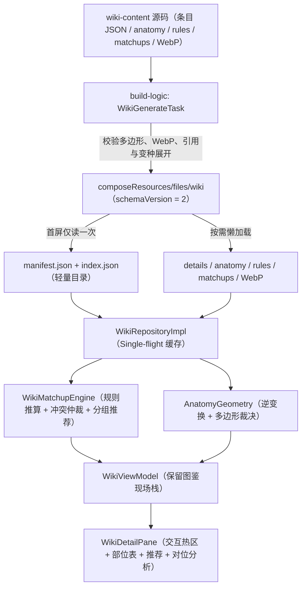

# Helldiver Trainer 游戏资料库第二期详细设计方案

本文档对应总方案 [wiki-design.md](./wiki-design.md) 中的 **第二期：敌人图鉴与对位分析**
，承接一期实现（[wiki-phase1-design.md](./wiki-phase1-design.md)），结合当前仓库技术栈（Kotlin `2.4.21`
、AGP `9.5.2` / `androidKotlinMultiplatformLibrary`、Compose Multiplatform `1.12.2`、Koin `4.2.2`、
`moko-resources` `0.27.1`、`kotlinx.serialization` `1.13.0`、`kotlinx-coroutines` `1.11.0`）与
`helldivers.wiki.gg` 素材实测结果，给出可直接落地的工程设计、数据契约与实施任务规划。

---

## 1. 二期范围、已拍板决策与改造清单

### 1.1 本期交付与明确边界

- **二期核心交付**：
    1. **敌人多视角每部位图鉴与透明点击映射**：每个视角存储各部位独立 WebP（单单位控制在 0.4–1.0
       MB，硬上限 <= 350 KB/张）；离线识别原图亮绿色高亮区域生成 RLE 区域映射表，以透明交互层覆盖在图片容器之上；点击部位切换对应图片（无
       Canvas 高亮），并支持多视角切换、手势缩放平移及 Sticky 图片容器 + 部位列表联动滚动（仅含 `MAIN`
       文字的主体图跳过点击映射，仅由列表点击切换）。
    2. **破甲前后状态预览**：支持在“完好 / 破甲后”间切换；切换至“破甲后”时根据 `onBreak`
       效果自动隐藏已剥离外甲热区、激活内部暴露组织热区与属性，并同步刷新推荐。
    3. **多分量武器对位推算引擎**
       ：支持武器与支援武器的多伤害分量（直击、爆炸等）分别按补丁护甲阶梯判定穿透，基于部位耐久与爆炸抗性估算单发部位伤害，显式标注“规则推算”及缺项（部分未知时不强行汇总击杀发数）。
    4. **实测冲突仲裁与按目的分组推荐**：当同补丁同条件下的 `MatchEvidence`
       与规则推算矛盾时，双方标签并存展示差异并标记“待复核”，同时从该版本自动推荐中剔除；推荐列表严格按部位状态与玩家目的分组，禁止外甲推荐串入暴露组织。
    5. **构建校验升级与首批二期样本**：升级 `build-logic`（`schemaVersion = 2`、多边形合法性校验、WebP
       规格校验、跨表引用校验），补齐首批敌人解剖热区、武器/支援武器多分量数据、实测表与推荐表。
- **本期不做（明确边界）**：
    - 不做在线增量热更新与远端高清图鉴包按需下载（留待四期）。
    - 不做本地 `Llamatik` AI 自由对话问答与路由联动（留待三期）。
    - 不改变一期已冻结的 114 条可训练战备同步清单签名（`StratagemStore.getAllStratagems()`
      ）与训练器勾选存档格式。

### 1.2 已拍板决策与前置清理项

1. **支援武器建模采用方案 A（保留单条目 + 挂载 `weaponProfile`）**：
    -
    支援武器条目继续在 [support_weapon.json](file:///c:/Users/za244/Helldiver_Trainer/wiki-content/stratagems/support_weapon.json)
    维护， **不拆分** 为独立 `weapons/` 条目。
    - 在
      `StratagemInputData`（[WikiBuildModels.kt](file:///c:/Users/za244/Helldiver_Trainer/build-logic/src/main/kotlin/cn/antares/helldiver_trainer/buildlogic/WikiBuildModels.kt)
      ）与
      `StratagemDetail`（[WikiPackModels.kt](file:///c:/Users/za244/Helldiver_Trainer/composeApp/src/commonMain/kotlin/cn/antares/helldiver_trainer/data/wiki/model/WikiPackModels.kt)
      ）中增加可选字段 `weaponProfile`，直接复用 `configurations[]` / `attacks[]` 及二期
      `components[]` 结构。
    - 二期 `AttackRef` 泛化为 `entryId + configId + attackId`，对位推算与推荐引擎统一同时索引
      `kind == WEAPON` 的条目和 `kind == STRATAGEM && stratagem?.weaponProfile != null` 的支援武器条目。
2. **敌人多视角素材采用 `helldivers.wiki.gg/zh` 解剖渲染图 + 每部位 WebP 与绿色 RLE 映射管线**：
    - 将每个视角下各部位渲染图直接等比压缩为 `1200×800` WebP（单张约 `60–100 KB`，单单位全视角合计约
      `0.4–1.0 MB`），切换部位直接切换对应图片，不使用 Canvas 描边或填充高亮。
    - 离线脚本通过绿通道与 HSV 色相提取各部位绿色高亮区域，按部位优先级合成为 `150×100` RLE 区域映射表（区分
      `intact`/`broken`）；仅含 `MAIN` 文字、无具体绿色区域的主体图显式跳过识别与点击映射，仅由部位列表点击切换。
3. **前置清理项（M0）**：
    - 开工前需先行清理当前 `git status` 中存在的多余暂存删除项（`AD` 状态），并确保一期全部单测及
      Desktop/Android 编译全绿后再进入 M1。

### 1.3 涉及文件与改造清单

| 类型           | 路径 / 模块                                                                                 | 职责说明                                                                                                                             |
|----------------|---------------------------------------------------------------------------------------------|--------------------------------------------------------------------------------------------------------------------------------------|
| 新增内容源     | `wiki-content/anatomy/<entryId>.json`                                                       | 存放每只敌人的多视角底图声明与归一化多边形热区                                                                                       |
| 新增内容源     | `wiki-content/assets/anatomy/<assetKey>.webp`                                               | 经缩放压缩的敌人各视角 WebP 底图                                                                                                     |
| 新增内容源     | `wiki-content/rules/damage_rules.json`                                                      | 按补丁版本维护护甲阶梯系数与规则说明                                                                                                 |
| 新增内容源     | `wiki-content/matchups/{evidence,recommendations}.json`                                     | 独立实测事实表 `MatchEvidence` 与按目的分组推荐表 `PartRecommendation`                                                               |
| 修改内容源     | `wiki-content/sources.json`、`enemies/`、`weapons/`、`stratagems/support_weapon.json`       | 补充协议署名字段、敌人血池/耐久/`onBreak`、武器多分量伤害及支援武器 `weaponProfile`                                                  |
| 修改构建插件   | `build-logic/src/main/kotlin/.../buildlogic/`                                               | 扩展输入/输出模型、`WikiValidator`（几何/WebP/跨表引用校验）、`WikiGenerator`（`schemaVersion = 2` 分片）                            |
| 修改数据模型   | `composeApp/src/commonMain/.../data/wiki/model/`                                            | 扩展 `WikiEnums.kt`、`WikiPackModels.kt`，新增 `WikiAnatomyModels.kt`、`WikiMatchupModels.kt`                                        |
| 新增对位引擎   | `composeApp/src/commonMain/.../data/wiki/matchup/`                                          | `WikiMatchupEngine`（保护层校验、分分量公式推算、实测冲突仲裁、分组推荐）与 `AnatomyGeometry.kt`（坐标逆变换与多边形命中裁决）       |
| 修改仓库层     | `composeApp/src/commonMain/.../data/wiki/repository/`                                       | `WikiRepository` / `WikiRepositoryImpl` 升级至 `schemaVersion = 2`，追加解剖加载、对位推算、推荐查询与 WebP 字节读取                 |
| 修改状态管理   | `composeApp/src/commonMain/.../viewmodel/WikiViewModel.kt`                                  | `DetailStackEntry` 扩展视角、选中部位、破甲预览态、推荐目的与对比攻击模式；支持跳转武器详情后返回恢复现场                            |
| 新增/修改 UI   | `composeApp/src/commonMain/.../ui/wiki/`                                                    | 在 `WikiDetailPane.kt` 接入交互图鉴组件（`EnemyAnatomyCanvas`、`EnemyPartList`、`EnemyMatchupSection`、`PartRecommendationSection`） |
| 新增测试与文档 | `composeApp/src/commonTest/.../wiki/`、`build-logic/src/test/`、`docs/wiki-update-guide.md` | 补齐二期几何/引擎/冲突仲裁/推荐/仓库/ViewModel 单测，并同步人工录入规范                                                              |

---

## 2. 目录结构与产物拓扑

### 2.1 二期目标目录树

```text
Helldiver_Trainer/
├── build-logic/src/main/kotlin/cn/antares/helldiver_trainer/buildlogic/
│   ├── WikiBuildModels.kt                 # 扩展来源协议、支援武器 profile、多分量、解剖、规则/实测/推荐模型
│   ├── WikiGeneratePlugin.kt              # 保持任务挂载与 Configuration Cache 兼容
│   ├── WikiGenerateTask.kt                # 校验并同步 anatomy_assets WebP 与 schemaVersion=2 离线包
│   ├── WikiValidator.kt                   # 新增多边形几何、WebP 头与体积、onBreak 闭环、跨表引用校验
│   └── WikiGenerator.kt                   # 生成 schemaVersion=2 的 manifest、anatomy/*.json、rules、matchups 与 WebP
├── wiki-content/
│   ├── sources.json                       # 扩展 license 与 attribution 字段
│   ├── rules/
│   │   └── damage_rules.json              # 按补丁维护穿甲/护甲阶梯规则表
│   ├── anatomy/                           # 敌人多视角与归一化热区定义（与 enemies/ 解耦避免单文件膨胀）
│   │   ├── hd2.enemy.scavenger.json
│   │   ├── hd2.enemy.charger.json
│   │   ├── hd2.enemy.charger_behemoth.json
│   │   └── hd2.enemy.hulk_bruiser.json
│   ├── assets/anatomy/                    # 1200x800 WebP 底图（<= 350 KB/张，禁止 SVG）
│   │   ├── scavenger_front.webp
│   │   ├── scavenger_side.webp
│   │   ├── charger_front.webp
│   │   ├── charger_side.webp
│   │   └── ...
│   ├── matchups/
│   │   ├── evidence.json                  # MatchEvidence 实测事实表
│   │   └── recommendations.json           # PartRecommendation 按目的分组推荐表
│   ├── stratagems/support_weapon.json     # 支援武器可选挂载 weaponProfile
│   ├── weapons/...                        # 攻击模式升级支持多伤害分量 components[]
│   └── enemies/...                        # 敌人补齐 pools[]、耐久/爆炸抗性/toMainRatio 与 onBreak[]
└── composeApp/src/commonMain/
    ├── composeResources/files/wiki/       # 构建期全量覆盖生成（仍保留在 .gitignore）
    │   ├── manifest.json                  # schemaVersion = 2
    │   ├── index.json                     # 保持轻量：不加载多边形几何与图片资源
    │   ├── rules.json                     # 编译后补丁规则表
    │   ├── details/{stratagem,weapon,enemy}.json
    │   ├── anatomy/<enemyId>.json         # 按敌人 ID 按需加载解剖与热区
    │   ├── anatomy_assets/<assetKey>.webp # 校验并复制后的底图资源
    │   └── matchups/
    │       ├── evidence.json              # 含按部位与按攻击双向索引
    │       └── recommendations.json       # 按编辑序整理的分组推荐索引
    └── kotlin/cn/antares/helldiver_trainer/
        └── data/wiki/
            ├── anatomy/AnatomyGeometry.kt # 坐标逆变换、射线法命中、重叠裁决
            ├── matchup/WikiMatchupEngine.kt
            ├── model/{WikiEnums,WikiFact,WikiPackModels,WikiAnatomyModels,WikiMatchupModels,WikiResult}.kt
            └── repository/{WikiRepository,WikiRepositoryImpl}.kt
```

### 2.2 模块与按需加载流向



---

## 3. 内容源与离线包数据契约（Schema 与 Kotlin 模型）

### 3.1 内容源 Schema 扩展（`wiki-content/`）

#### （1）`sources.json` 增加版权与署名字段

在保持一期字段向后兼容的前提下，为 `WikiSourceRecord` / `WikiSource` 增加两个可选字段：

```json
{
  "sourceId": "wikigg_charger",
  "title": "Helldivers Wiki - Charger",
  "sourceType": "wiki_gg",
  "location": "Helldivers Wiki",
  "url": "https://helldivers.wiki.gg/wiki/Charger",
  "verifiedDate": "2026-11-24",
  "defaultPatch": "01.001.200",
  "license": "CC BY-NC-SA 4.0",
  "attribution": "Helldivers Wiki Contributors (helldivers.wiki.gg)"
}
```

#### （2）支援武器 `weaponProfile` 与攻击多分量 `components[]`

为了兼容一期已录入的旧字段（`damage` / `armorPenetration`）并支持二期多分量拆解（如“直击弹头 + 范围爆炸”）：

- **单条武器攻击输入 `WeaponAttackInput`**：
    - 保留一期可选字段 `damage: WikiFact<Int>`、`armorPenetration: WikiFact<Int>`（仅作兼容或简表展示）。
    - 新增 `components: List<WeaponDamageComponentInput>`，每项包含：
        - `componentId`（同攻击内唯一，如 `direct_impact`、`aoe_explosion`）
        - `labelZh`（如 `"直击穿甲弹"`、`"范围高爆"`）
        - `componentKind`（枚举：`direct` / `explosive` / `fire` / `status`）
        - `normalDamage: WikiFact<Int>`、`durableDamage: WikiFact<Int>`、
          `armorPenetration: WikiFact<Int>`
        - `innerRadiusMeters: Double?`、`outerRadiusMeters: Double?`（爆炸分量可选）
        - `sourceId: String?`、`verifiedPatch: String?`、`condition: String?`
- **支援武器方案 A 挂载**：`StratagemInputData` 新增可选字段 `weaponProfile: WeaponProfileInput?`（仅
  `category == "support_weapon"` 或带有武器数据的攻击战备允许使用，内含
  `configurations: List<WeaponConfigInput>`）。

```json
{
  "entryId": "hd2.stratagem.autocannon",
  "kind": "stratagem",
  "nameZh": "机炮",
  "stratagem": {
    "category": "support_weapon",
    "directions": ["DOWN", "LEFT", "DOWN", "UP", "UP", "RIGHT"],
    "weaponProfile": {
      "configurations": [
        {
          "configId": "apher_mode",
          "labelZh": "穿甲高爆（APHET）",
          "modelCode": "AC-8",
          "magazineCapacity": { "status": "known", "value": 10, "unit": "rounds" },
          "attacks": [
            {
              "attackId": "aphet_round",
              "nameZh": "20mm 穿甲高爆弹",
              "components": [
                {
                  "componentId": "projectile",
                  "labelZh": "弹头直击",
                  "componentKind": "direct",
                  "normalDamage": { "status": "known", "value": 260 },
                  "durableDamage": { "status": "known", "value": 260 },
                  "armorPenetration": { "status": "known", "value": 4 }
                },
                {
                  "componentId": "blast",
                  "labelZh": "近距爆炸",
                  "componentKind": "explosive",
                  "normalDamage": { "status": "known", "value": 150 },
                  "durableDamage": { "status": "known", "value": 150 },
                  "armorPenetration": { "status": "known", "value": 3 },
                  "innerRadiusMeters": 1.0,
                  "outerRadiusMeters": 3.0
                }
              ]
            }
          ]
        }
      ]
    }
  }
}
```

#### （3）敌人血池、部位参数与 `onBreak[]` 扩展

以 `helldivers.wiki.gg/wiki/Charger` 实测数据为例，二期在 `EnemyInputData` 新增 `mainPoolId` 与
`pools[]`，并在 `EnemyPartInput` 新增血池引用、耐久度、主血池传导比例、爆炸抗性、前置保护层及破坏后果：

```json
{
  "entryId": "hd2.enemy.charger",
  "kind": "enemy",
  "nameZh": "强袭虫",
  "enemy": {
    "faction": "terminid",
    "sizeClass": "heavy",
    "familyKey": "charger",
    "mainPoolId": "main",
    "pools": [
      {
        "poolId": "main",
        "labelZh": "主体血池",
        "maxHealth": { "status": "known", "value": 2400 },
        "bleedHealth": 750,
        "bleedRatePerSecond": 100.0,
        "isMain": true
      },
      { "poolId": "head_pool", "labelZh": "头部甲壳", "maxHealth": { "status": "known", "value": 1200 } },
      { "poolId": "left_front_plate_pool", "labelZh": "左前腿外甲", "maxHealth": { "status": "known", "value": 800 } },
      { "poolId": "left_front_flesh_pool", "labelZh": "左前腿内部组织", "maxHealth": { "status": "known", "value": 800 } },
      { "poolId": "abdomen_pool", "labelZh": "尾部腹部", "maxHealth": { "status": "known", "value": 950 } }
    ],
    "parts": [
      {
        "partId": "left_front_leg_plate",
        "nameZh": "左前腿外甲",
        "healthPoolRef": "left_front_plate_pool",
        "armor": { "status": "known", "value": 4 },
        "durability": { "status": "known", "value": 0.70 },
        "toMainRatio": { "status": "known", "value": 0.60 },
        "damageCapToMain": false,
        "explosionResistance": { "status": "known", "value": 0.25 },
        "onBreak": [
          {
            "effectType": "expose_part",
            "targetPartId": "left_front_leg_flesh",
            "descriptionZh": "外甲剥落，暴露 AV2 内部腿部组织",
            "sourceId": "wikigg_charger"
          }
        ]
      },
      {
        "partId": "left_front_leg_flesh",
        "nameZh": "左前腿内部组织",
        "healthPoolRef": "left_front_flesh_pool",
        "armor": { "status": "known", "value": 2 },
        "durability": { "status": "known", "value": 0.70 },
        "toMainRatio": { "status": "known", "value": 0.50 },
        "damageCapToMain": false,
        "explosionResistance": { "status": "known", "value": 0.25 },
        "protectedByPartIds": ["left_front_leg_plate"],
        "onBreak": [
          {
            "effectType": "fatal",
            "descriptionZh": "腿部内部血池归零直接致死",
            "sourceId": "wikigg_charger"
          }
        ]
      }
    ]
  }
}
```

- **变种继承扩展**：`EnemyPartOverrideInput` 同步支持局部覆写 `healthPoolRef`、`durability`、
  `toMainRatio`、`damageCapToMain`、`explosionResistance`、`protectedByPartIds` 与 `onBreak`，以及
  `EnemyInputData.poolOverrides` 覆写变种血池上限（如巨兽强袭虫头部与主血池提升）；构建期展开为自包含的完整
  `pools` 与 `parts`。

#### （4）多视角与归一化热区文件（`wiki-content/anatomy/<entryId>.json`）

每只已录入图鉴的敌人维护独立文件，坐标按底图宽高归一化到 `[0.0, 1.0]`（左上角为 `(0, 0)`，右下角为
`(1, 1)`）：

```json
{
  "enemyId": "hd2.enemy.charger",
  "defaultViewId": "front",
  "views": [
    {
      "viewId": "front",
      "labelZh": "正面视角",
      "assetKey": "charger_front",
      "assetRevision": "layout_1",
      "width": 1200,
      "height": 800,
      "sourceId": "wikigg_charger",
      "regions": [
        {
          "regionId": "front_left_leg_plate",
          "partId": "left_front_leg_plate",
          "polygon": [[0.62, 0.48], [0.73, 0.50], [0.69, 0.79], [0.60, 0.71]],
          "priority": 20,
          "visibleWhen": { "partId": "left_front_leg_plate", "state": "intact" }
        },
        {
          "regionId": "front_left_leg_flesh",
          "partId": "left_front_leg_flesh",
          "polygon": [[0.63, 0.50], [0.71, 0.52], [0.68, 0.77], [0.61, 0.70]],
          "priority": 25,
          "visibleWhen": { "partId": "left_front_leg_plate", "state": "broken" }
        }
      ]
    }
  ]
}
```

#### （5）补丁规则表、实测事实表与推荐表

1. **`wiki-content/rules/damage_rules.json`**：
   ```json
   {
     "ruleSets": [
       {
         "patchVersion": "01.001.200",
         "penetrateMultiplier": 1.0,
         "equalArmorMultiplier": 0.65,
         "ricochetMultiplier": 0.0,
         "notes": "AP > AV 全额穿透 (100%)；AP == AV 等甲折减 (65%)；AP < AV 跳弹 (0%)。",
         "sourceId": "wikigg_damage_mechanics"
       }
     ]
   }
   ```
2. **`wiki-content/matchups/evidence.json`**（`MatchEvidence`）：
   ```json
   {
     "evidences": [
       {
         "evidenceId": "ev_charger_behemoth_leg_eat_01001200",
         "enemyId": "hd2.enemy.charger_behemoth",
         "partId": "left_front_leg_plate",
         "partState": "intact",
         "attackRef": {
           "entryId": "hd2.stratagem.sw_expendable_anti_tank",
           "configId": "base",
           "attackId": "at_rocket"
         },
         "hitCondition": "标准直击（忽略前冲速度增益）",
         "verdict": "strips_armor",
         "shotsToBreak": { "status": "known", "value": 1, "unit": "shots" },
         "summaryZh": "实测一发直击即可剥离前腿外甲并暴露内部组织。",
         "patchVersion": "01.001.200",
         "sourceId": "wikigg_charger_behemoth"
       }
     ]
   }
   ```
3. **`wiki-content/matchups/recommendations.json`**（`PartRecommendation`）：
   ```json
   {
     "recommendations": [
       {
         "recId": "rec_charger_leg_strip_eat",
         "enemyId": "hd2.enemy.charger",
         "partId": "left_front_leg_plate",
         "partState": "intact",
         "goal": "strip_armor",
         "attackRef": {
           "entryId": "hd2.stratagem.sw_expendable_anti_tank",
           "configId": "base",
           "attackId": "at_rocket"
         },
         "priorityOrder": 1,
         "condition": "正面直击腿甲",
         "reasonZh": "单发即可剥离重甲外层，随后任意轻穿主武器可快速收割。",
         "evidenceIds": ["ev_charger_leg_eat_01001200"],
         "patchVersion": "01.001.200",
         "sourceId": "wikigg_charger"
       }
     ]
   }
   ```

### 3.2 二期离线包 `manifest.json`（`schemaVersion = 2`）

```json
{
  "schemaVersion": 2,
  "packVersion": "2.0.0",
  "generatedFromAppVersion": "1.8.0",
  "entryCount": 122,
  "indexPath": "files/wiki/index.json",
  "detailPaths": {
    "stratagem": "files/wiki/details/stratagem.json",
    "weapon": "files/wiki/details/weapon.json",
    "enemy": "files/wiki/details/enemy.json"
  },
  "rulesPath": "files/wiki/rules.json",
  "anatomyPaths": {
    "hd2.enemy.scavenger": "files/wiki/anatomy/hd2.enemy.scavenger.json",
    "hd2.enemy.charger": "files/wiki/anatomy/hd2.enemy.charger.json",
    "hd2.enemy.charger_behemoth": "files/wiki/anatomy/hd2.enemy.charger_behemoth.json",
    "hd2.enemy.hulk_bruiser": "files/wiki/anatomy/hd2.enemy.hulk_bruiser.json"
  },
  "anatomyAssetPaths": {
    "charger_front": "files/wiki/anatomy_assets/charger_front.webp"
  },
  "evidencePath": "files/wiki/matchups/evidence.json",
  "recommendationsPath": "files/wiki/matchups/recommendations.json"
}
```

### 3.3 核心 Kotlin 模型设计（`data/wiki/model/`）

```kotlin
@Serializable
data class AttackRef(
    val entryId: String,
    val configId: String,
    val attackId: String,
)

@Serializable
enum class DamageComponentKind {
    @SerialName("direct") DIRECT,
    @SerialName("explosive") EXPLOSIVE,
    @SerialName("fire") FIRE,
    @SerialName("status") STATUS,
}

@Serializable
enum class EnemyPartState(val labelZh: String) {
    @SerialName("intact") INTACT("完好"),
    @SerialName("broken") BROKEN("破甲后"),
}

@Serializable
enum class RecommendationGoal(val labelZh: String) {
    @SerialName("strip_armor") STRIP_ARMOR("破除外甲"),
    @SerialName("kill") KILL("直接击杀"),
    @SerialName("disable_ability") DISABLE_ABILITY("限制能力"),
    @SerialName("attack_exposed") ATTACK_EXPOSED("攻击暴露肉体"),
}

@Serializable
enum class PartBreakEffectType(val labelZh: String) {
    @SerialName("expose_part") EXPOSE_PART("暴露内部部位"),
    @SerialName("disable_ability") DISABLE_ABILITY("失去能力"),
    @SerialName("bleed_out") BLEED_OUT("流血延迟死亡"),
    @SerialName("fatal") FATAL("立即致死"),
}

@Serializable
enum class MatchVerdict(val labelZh: String) {
    @SerialName("penetrates") PENETRATES("有效穿透"),
    @SerialName("reduced") REDUCED("等甲折减"),
    @SerialName("ricochet") RICOCHET("跳弹无法穿透"),
    @SerialName("strips_armor") STRIPS_ARMOR("可破除外甲"),
    @SerialName("kills") KILLS("可击杀"),
    @SerialName("blocked") BLOCKED("受外甲阻挡"),
    @SerialName("unknown") UNKNOWN("待核验"),
}
```

---

## 4. 素材加工工作流与 `build-logic` 升级

### 4.1 `helldivers.wiki.gg` 素材离线提取工作流

针对 `helldivers.wiki.gg` 的解剖图组（同视角 `Main` 底图 + 各部位高亮 PNG，均为 `2000×1333`
），编写本地一次性处理脚本（放入工程外或工具脚本目录，不打包进运行时）：

1. **下载并登记**：按页面批量获取同视角图组，登记 `sourceId`、`url`、`verifiedDate`、
   `license = "CC BY-NC-SA 4.0"` 与 `attribution`。
2. **生成轻量 WebP 底图**：将各视角的 `Main` PNG 等比缩放为 **`1200×800`**（或按长边 `1200px`
   等比），以有损/近无损 WebP（质量 `80–85`）编码输出至 `wiki-content/assets/anatomy/<assetKey>.webp`
   ，目标单张控制在 `80–200 KB` 之间。
3. **差分半自动提取热区多边形**：将同视角下的部位高亮图与 `Main` 图按像素做 RGB 差分掩码 →
   提取最大连通域轮廓 → 使用 Douglas-Peucker 算法简化为 6–24 个顶点并归一化到 `[0.0, 1.0]` → 写入
   `wiki-content/anatomy/<enemyId>.json` 供人工在可视化预览下微调边界与重叠 `priority`。

### 4.2 `build-logic` 校验规则扩展（`WikiValidator.kt`）

在保留一期全量校验（唯一性、`training.order` 连续性、关系防环、`WikiFact` 四态规范）基础上，
`WikiValidator` 新增二期校验：

| 校验域                           | 具体校验规则（任一不通过即中断构建并按统一格式报错）                                                                                                                                                                                                                          |
|----------------------------------|-------------------------------------------------------------------------------------------------------------------------------------------------------------------------------------------------------------------------------------------------------------------------------|
| **多边形合法性**                 | 顶点数 `>= 3`；相邻顶点与首尾顶点不可重合（距离 `> 1e-5`）；全部坐标 `x, y ∈ [0.0, 1.0]`；鞋带公式计算有向面积绝对值 `> 1e-6`；任意两条非相邻线段不得相交或重叠                                                                                                               |
| **WebP 底图规格**                | `anatomy_assets` 下仅允许 `.webp`（**严禁 `.svg`**）；每个 `view.assetKey` 对应文件必须存在、`assetRevision` 非空；解析 WebP 文件头（`RIFF`/`WEBP` + `VP8`/`VP8L`/`VP8X`）核验分辨率 `<= 1200×900`、宽高比与 `view.width / view.height` 一致、单文件体积 `<= 350 KB`          |
| **解剖与状态闭环**               | `defaultViewId` 必须存在于 `views[]`；`mainPoolId` 与每个部位 `healthPoolRef` 必须存在于 `pools[]`；`protectedByPartIds`、`onBreak[].targetPartId`、`visibleWhen.partId` 必须存在于该敌人展开后的 `parts[]` 中，且保护链禁止自指或成环                                        |
| **武器多分量与 `weaponProfile`** | 仅 `support_weapon` 或许可战备允许挂载 `weaponProfile`；同 `attack` 内 `componentId` 唯一；`durability` 与 `explosionResistance` 在 `KNOWN` 时必须位于 `[0.0, 1.0]`，`toMainRatio` 必须 `>= 0.0`                                                                              |
| **跨表引用完整性**               | `MatchEvidence` 与 `PartRecommendation` 中的 `(enemyId, partId)` 必须存在；`attackRef(entryId, configId, attackId)` 必须在目标 `weapon` 或 `stratagem.weaponProfile` 中真实存在；`evidenceIds`、`sourceId`、`patchVersion`（须在 `damage_rules.json` 中有定义或显式标注）合法 |
| **版权字段提示**                 | 当 `sourceType == "wiki_gg"` 时，校验 `license` 与 `url` 非空，防止漏登 CC BY-NC-SA 4.0 署名元数据                                                                                                                                                                            |

### 4.3 `WikiGenerator.kt` 与 `WikiGenerateTask.kt` 升级

- `WikiGenerateTask` 继续标记 `@CacheableTask` 并仅通过 `@InputDirectory` / `@OutputDirectory`
  访问文件（保持与 Gradle Configuration Cache 及 AGP `9.5.2` 完全兼容），额外将
  `wiki-content/assets/anatomy/` 下校验通过的 `.webp` 同步至
  `composeResources/files/wiki/anatomy_assets/`。
- `WikiGenerator` 输出 `schemaVersion = 2` 清单； **`index.json`
  保持一期轻量结构，不写入多边形、血池或图片路径**；按敌人 ID 单独输出 `anatomy/<enemyId>.json`；为
  `matchups/evidence.json` 构建按 `enemyId::partId` 与 `entryId::configId::attackId` 的双索引表以便
  O (1) 检索；`matchups/recommendations.json` 严格保留同组编辑顺序。

---

## 5. 武器对位推算、实测冲突仲裁与分组推荐引擎

本模块全部实现在 `commonMain` 下的纯 Kotlin 引擎 `WikiMatchupEngine`（无 Compose/Android/JVM
依赖），便于全覆盖单元测试与后续三期 Agent 复用。

### 5.1 分分量规则推算流程（`evaluateMatchup`）

输入
`MatchupQueryContext(enemyDetail, partId, partState, attackOwnerEntry, configId, attackId, attack, ruleSet, evidences, hitCondition)`：

1. **保护层拦截判断**：
    - 若 `partState == EnemyPartState.INTACT` 且 `part.protectedByPartIds` 非空，则直接返回
      `overallVerdict = MatchVerdict.BLOCKED`，`blockedByPartIds = part.protectedByPartIds`，提示文案为
      `"当前状态无法直接命中此部位，需先破坏：${外甲中文名}"`。
2. **分分量遍历计算**：
    - 规范化获取攻击分量列表：若 `attack.components` 非空则直接遍历；否则兼容一期单层字段包装为单个
      `DIRECT` 分量（此时 `durableDamage` 自动视为 `UNKNOWN`）。
    - 对每个分量分别执行：
        - **护甲阶梯判定**：对比 `component.armorPenetration` 与 `part.armor`：
            - 任意一方非 `KNOWN` → 穿甲结论为 `UNKNOWN`，记录缺项（`"穿甲或护甲等级未知"`）。
            - `AP > AV` → `PENETRATES`（倍率 `ruleSet.penetrateMultiplier = 1.0`）。
            - `AP == AV` → `REDUCED`（倍率 `ruleSet.equalArmorMultiplier = 0.65`）。
            - `AP < AV` → `RICOCHET`（倍率 `ruleSet.ricochetMultiplier = 0.0`，单发分量伤害计为
              `0.0`）。
        - **单发部位伤害估算**：
            - 若穿甲为跳弹（`0.0`），单发伤害确定为 `0.0`。
            - 若穿透或折减，且 `normalDamage`、`durableDamage`、`part.durability` 均为 `KNOWN`：
              $$\text{PartDamage} = \big ((1 - d) \times \text{NormalDamage} + d \times \text{DurableDamage}\big) \times m_{\text{armor}} \times m_{\text{explosive}}$$
              其中 $d \in [0, 1]$ 为部位耐久度，$m_{\text{armor}}$ 为护甲系数；仅当分量类型为
              `EXPLOSIVE` 时再乘 $m_{\text{explosive}} = 1 - \text{explosionResistance}$（若
              `explosionResistance` 为 `UNKNOWN`，标记缺项“爆炸抗性未知”且不强行折算数值）。
            - 任何必要数值为 `UNKNOWN` 时，该分量仅输出穿甲判定而不输出具体单发伤害，并显式记录缺项（如
              `"缺少耐久伤害，无法估算单发部位伤害"`）；同时对未建模因素统一附带前置条件说明（如
              `"未计距离衰减与命中角度"`）。
3. **跨分量汇总规则**：
    - 仅当所有 **实际有效**分量（非 `STATUS`）的单发伤害都已成功算出、且目标部位所属血池 `maxHealth` 与
      `toMainRatio` 为 `KNOWN` 时，才计算 `estimatedShotsToBreak`（`ceil(poolHealth / sumPartDamage)`
      ）并标注 **“规则推算”**。
    - **只要存在任意未知分量，严禁强行汇总“击杀发数 / 破甲发数”**，界面只逐分量展示已知判定与“待核验”缺项。

### 5.2 实测与推算冲突仲裁

在 `evaluateMatchup` 中按 `(enemyId, partId, partState, attackRef)` 检索 `evidences`：

- **版本与条件过滤**：
    - 优先匹配 `evidence.patchVersion == targetPatch` 且条件相符的实测记录。
    - **不同补丁**（`evidence.patchVersion != targetPatch`）或命中条件明显不同（如标明特殊状态/bug）的记录，仅归入
      `historicalEvidences` 作历史参考， **绝不用于产出当前补丁确定性结论，也不参与冲突判定**。
- **同补丁冲突识别与处理**：
    - 对比同补丁规则推算结论与实测结论 `evidence.verdict`：
        - 若出现实质性方向矛盾（例如：规则判定为 `RICOCHET` 跳弹但实测为 `STRIPS_ARMOR` /
          `PENETRATES` / `KILLS`；或规则推算为有效穿透但实测明确记录 `RICOCHET` / `BLOCKED`；或已知推算发数与
          `shotsToBreak`/`shotsToKill` 存在明显背离），则判定为 **`ConflictStatus.NEEDS_REVIEW`
          （待复核）**。
    - **展示与剔除规则**：
        - `MatchupEvaluation` 同时携带 `ruleResult`（标“规则推算”）与 `matchedEvidences`（标“实测记录”）及
          `conflictReasonZh`，UI 并存渲染双方差异并展示黄色/红色“待复核”角标。
        - 该 `(partRef, partState, attackRef, targetPatch)` 组合在 **`recommendForPart` 中自动剔除**
          ，防止把存疑结论推送给玩家。

### 5.3 按目的分组推荐（`recommendForPart`）

给定 `(enemyId, partId, partState, goal, patchVersion)`：

1. **状态与目的隔离校验**：
    - 当 `partState == INTACT` 且部位被外甲保护（`protectedByPartIds` 非空）时，直接返回空推荐并提示需先破坏外甲，
      **绝不把外甲破甲推荐套用到内部组织**。
    - 仅返回符合当前 `partState` 与 `goal` 分组的推荐（如外甲对应 `STRIP_ARMOR` / `DISABLE_ABILITY`
      ；暴露组织对应 `ATTACK_EXPOSED` / `KILL`）。
2. **两段式结果排序**：
    - **第一段 · 编辑实证推荐（`curatedRecommendations`）**：从 `recommendations.json` 筛选匹配
      `enemyId + partId + partState + goal + patchVersion` 的条目， **剔除被仲裁标记为 `NEEDS_REVIEW`
      的组合**，按 `priorityOrder ASC`（保持编辑录入顺序）展示，绝不强行捏造单一综合总评分。
    - **第二段 · 其他可用武器（`otherViableWeapons`）**：扫描具备完整攻击分量的 `weapon` 与
      `stratagem.weaponProfile`，排除已出现在第一段或被标记 `NEEDS_REVIEW` 的条目；对每个候选调用
      `evaluateMatchup`，仅保留非 `RICOCHET` / 非 `BLOCKED` 且至少一个分量有效穿透/折减的武器攻击，按“穿透档位（
      `PENETRATES` 优先于 `REDUCED`）→ 单发推算伤害（若已知）→ 名称与 `entryId`”稳定排序。

---

## 6. 仓库接口、状态机与热区交互 UI 设计

### 6.1 `WikiRepository` 二期扩展接口

在 [WikiRepository.kt](file:///c:/Users/za244/Helldiver_Trainer/composeApp/src/commonMain/kotlin/cn/antares/helldiver_trainer/data/wiki/repository/WikiRepository.kt)
中保留一期 4 个方法不变，追加二期 4 个方法：

```kotlin
interface WikiRepository {
    // 一期既有接口（保持签名不变）
    suspend fun ensureInitialized(): WikiResult<Unit>
    suspend fun search(request: WikiSearchRequest): WikiResult<List<WikiSearchHit>>
    suspend fun getEntry(entryId: String): WikiResult<WikiEntryBundle>
    suspend fun related(entryId: String): WikiResult<List<WikiRelatedItem>>

    // 二期扩展接口
    suspend fun getAnatomy(enemyId: String): WikiResult<EnemyAnatomyBundle>
    suspend fun readAnatomyImageBytes(assetKey: String): WikiResult<ByteArray>
    suspend fun evaluateMatchup(context: MatchupEvaluateRequest): WikiResult<MatchupEvaluation>
    suspend fun recommendForPart(
        partRef: EnemyPartRef,
        state: EnemyPartState,
        goal: RecommendationGoal,
        patch: String? = null,
    ): WikiResult<PartRecommendationResult>
}
```

-
**版本与并发保护（[WikiRepositoryImpl.kt](file:///c:/Users/za244/Helldiver_Trainer/composeApp/src/commonMain/kotlin/cn/antares/helldiver_trainer/data/wiki/repository/WikiRepositoryImpl.kt)）**：
    - 将 `SUPPORTED_SCHEMA_VERSION` 升级为 `2`；若检测到旧版或未来不兼容版本，继续返回
      `WikiResult.UnsupportedVersion`。
    - 对 `anatomyCache`（按 `enemyId`）、`rulesCache`、`evidenceCache`、`recommendationsCache` 与
      `anatomyImageCache` 沿用一期 `Mutex + Deferred` 的 Single-flight 并发合并机制；
      **读取或解析失败绝不写入缓存**，支持界面原位重试。
    - 若某敌人尚未录入交互图鉴（`manifest.anatomyPaths[enemyId] == null`），`getAnatomy(enemyId)` 返回
      `WikiResult.Missing(enemyId)`，详情页优雅降级为一期静态部位护甲表。

### 6.2 `WikiViewModel` 现场状态与恢复

在 [WikiViewModel.kt](file:///c:/Users/za244/Helldiver_Trainer/composeApp/src/commonMain/kotlin/cn/antares/helldiver_trainer/viewmodel/WikiViewModel.kt)
中扩展 `DetailStackEntry`，使图鉴现场随详情栈完整保存：

```kotlin
data class DetailStackEntry(
    val entryId: String,
    val scrollIndex: Int = 0,
    val scrollOffset: Int = 0,
    // 二期敌人交互图鉴现场状态
    val viewId: String? = null,
    val selectedPartId: String? = null,
    val previewState: EnemyPartState = EnemyPartState.INTACT,
    val goal: RecommendationGoal? = null,
    val selectedAttackRef: AttackRef? = null,
    val targetPatch: String? = null,
)
```

**关键交互流转规则**：

1. **切换视角（`selectAnatomyView(viewId)`）**：更新当前栈顶 `viewId`， **保留 `selectedPartId` 与
   `previewState`**，不重置用户已选部位。
2. **点选部位（`selectAnatomyPart(partId)`）**：热区点击与部位列表点击调用同一动作；更新
   `selectedPartId` 后，自动按当前 `previewState` 调整默认 `goal`（外甲完好时优先 `STRIP_ARMOR`，暴露组织优先
   `ATTACK_EXPOSED` / `KILL`），并发起推荐与（若已选对比武器）对位刷新。
3. **切换“完好 / 破甲后”（`setPreviewState(state)`）**：
    - 当从 `INTACT` 切到 `BROKEN` 时，检查当前 `selectedPartId` 的 `onBreak`：若存在 `EXPOSE_PART` 且其
      `targetPartId` 有效，自动将 `selectedPartId` 切换至该暴露部位（否则若当前部位在 `BROKEN`
      下仍可见则保留），并自动重置 `goal` 为适配新部位的目的（如 `ATTACK_EXPOSED`），随即重新加载推荐与对位结论。
4. **点击推荐武器卡（`openRecommendedAttack(attackRef)`）**：将目标武器/支援武器 `attackRef.entryId` 经
   `openRelatedItem` 压入 `detailStack`，旧的敌人 `DetailStackEntry` 连同 `viewId`、`selectedPartId`、
   `previewState`、`goal` 原封不动留在栈中；用户点击返回出栈时，
   **原样恢复刚才的敌人视角、破甲状态与推荐面板**。

### 6.3 热区几何与坐标逆变换（`AnatomyGeometry.kt`）

为保证 Android 触控与 Desktop 鼠标点击在不同尺寸容器及缩放/平移下与 Canvas 描边 **零像素偏差**：

1. **计算等比适配基础矩形**：设容器像素尺寸为 $(W_c, H_c)$，底图逻辑像素为 $(W_i, H_i)$，按
   `ContentScale.Fit` 计算基准缩放因子 $s_0 = \min (W_c / W_i,\ H_c / H_i)$
   ，绘制宽高 $(W_d, H_d) = (W_i s_0, H_i s_0)$
   ，居中留白偏移 $(O_x, O_y) = \big ((W_c - W_d)/2,\ (H_c - H_d)/2\big)$。
2. **手势缩放与平移逆变换**：设当前用户手势缩放倍率 $z \ge 1$
   （以容器中心为基准点）和平移像素 $(T_x, T_y)$，容器中心 $(C_x, C_y) = (W_c/2, H_c/2)$
   。给定触点 $(x_t, y_t)$：
   $$x_{\text{fit}} = \frac{x_t - T_x - C_x}{z} + C_x, \qquad y_{\text{fit}} = \frac{y_t - T_y - C_y}{z} + C_y$$
   再扣除留白偏移并归一化：
   $$u = \frac{x_{\text{fit}} - O_x}{W_d}, \qquad v = \frac{y_{\text{fit}} - O_y}{H_d}$$
   若 $u \notin [0, 1]$ 或 $v \notin [0, 1]$，直接判定为点击留白区域。
3. **多边形命中与重叠裁决**：
    - 先过滤出满足当前 `previewState` 可见条件（`visibleWhen`）的区域；
    - 用射线法（Ray-Casting，对边界点亦容差判定）筛选包含 $(u, v)$ 的候选 `AnatomyRegion`；
    - **稳定裁决排序**：`priority DESC` → 多边形归一化面积 `polygonArea ASC` → `regionId ASC`；
    - **点中空白**：不清空、不改变当前 `selectedPartId`。
4. **Canvas 同源绘制**：将每个可见多边形点 $(p_x, p_y)$ 按完全相反的正变换映射回屏幕像素坐标，用
   Compose `Canvas` 绘制半透明填充与描边（选中态使用 `MaterialTheme.colorScheme.primary`
   ，破甲可暴露部位用区分色虚线或角标提示）。

### 6.4 跨平台 WebP 加载与双端 UI 布局

- **跨平台 WebP 解码**：通过 `WikiRepository.readAnatomyImageBytes(assetKey)` 读取 `ByteArray`，在
  `commonMain` 使用 Compose Multiplatform 内置的
  `org.jetbrains.compose.resources.decodeToImageBitmap()`（或封装 `bridge/ImageDecoder.kt` 在 Android
  `BitmapFactory` / Desktop Skia `Image.makeFromEncoded` 解码为 `ImageBitmap`；实施 M3 时实测
  `decodeToImageBitmap` 在当前 Compose `1.12.2`
  的双端可用性后二选一落地），并配合记忆化缓存避免重组重复解码。图片读取或解码失败时，图鉴画布展示温和提示与“重试”，
  **下方的文字部位列表、属性与推荐面板全程不受影响、照常可用**。
- **响应式排版与主题一致**：
    -
    延续 [WikiDetailPane.kt](file:///c:/Users/za244/Helldiver_Trainer/composeApp/src/commonMain/kotlin/cn/antares/helldiver_trainer/ui/wiki/WikiDetailPane.kt)
    卡片底色（`0xFF2B2B2B` / `0xFF323232`）与 `1.dp` 低透明白边，高亮跟随 4 套阵营主题 `primary`：
        - **窄屏（`< 840.dp`）**：详情滚动流自上而下依次为：身份识别区 → **交互解剖画布（视角切换 Chip +
          完好/破甲开关 + 重置缩放按钮）** → **可键盘聚焦（`focusable` + `semantics`）部位列表** →
          **选中部位详情与 `onBreak` 效果** → **按目的分组推荐卡** → **武器对位分析器** →
          说明与关联 → 资料来源与版权署名。
        - **宽屏（`>= 840.dp`）**：右侧详情区内可并排放置“交互图鉴画布 +
          部位列表”，下方承接部位详情、推荐与对位分析，保证桌面端一屏可见画布与列表联动高亮。

---

## 7. 首批样本清单、测试矩阵与实施里程碑

### 7.1 首批二期录入样本规划

| 类别               | 拟补齐/升级样本                                                                                                                                                                                                                                                                                                                                | 验证的二期核心机制                                                                                                  |
|--------------------|------------------------------------------------------------------------------------------------------------------------------------------------------------------------------------------------------------------------------------------------------------------------------------------------------------------------------------------------|---------------------------------------------------------------------------------------------------------------------|
| **敌人（4）**      | `hd2.enemy.scavenger`（按 wiki.gg 拆细为 `main`/`head`/`limbs`，配正面/侧面 WebP）<br>`hd2.enemy.charger`（主血池+头/左前腿外甲/左前腿暴露肉体/腹部，正面/侧面 WebP）<br>`hd2.enemy.charger_behemoth`（继承展开 + 局部覆写血池与部位参数，复用/独立视角）<br>`hd2.enemy.hulk_bruiser`（正面观察眼 AP4 + 背面散热器 AP0，正面/背面/侧面多视角） | 多视角切换与保留选中；外甲完好阻挡内部组织；切“破甲后”隐藏外甲激活暴露肉体；变种 `extends` 展开二期血池与 `onBreak` |
| **武器与支援武器** | 主武器：`hd2.weapon.liberator`（AP2）、`hd2.weapon.liberator_penetrator`（AP3）<br>投掷物：`hd2.weapon.g12_high_explosive`（多分量/高爆 AP4）<br>支援武器（`support_weapon.json` 挂载 `weaponProfile`）：`hd2.stratagem.autocannon`（直击 AP4 + 爆炸 AP3 双分量）、反坦克支援武器（如 `sw_expendable_anti_tank` / 无后坐力炮，高穿破甲主力）   | 支援武器方案 A 跨类参与计算；轻/中/重/反坦克多档穿甲判定；直击+爆炸多分量拆解与部分未知不汇总保护                   |
| **实测与推荐**     | `damage_rules.json`（`01.001.200` 阶梯规则）<br>`evidence.json`（含正常破甲实证、1 条跨补丁历史参考、1 条同补丁故意冲突样本用于验证仲裁）<br>`recommendations.json`（强袭虫前腿“破除外甲” vs 暴露肉体“攻击暴露肉体”，浩劫屠夫“正面观察眼” vs “背面散热器”）                                                                                    | 同补丁实测冲突标“待复核”并自动剔除推荐；跨补丁隔离；外甲与暴露肉体推荐严格隔离                                      |

### 7.2 单元测试矩阵

| 测试位置                  | 测试文件 / 用例范围                                                                                                                                                                                                                                                                           |
|---------------------------|-----------------------------------------------------------------------------------------------------------------------------------------------------------------------------------------------------------------------------------------------------------------------------------------------|
| `build-logic` 单测        | 1. 非法多边形拦截（少于 3 点、重复点、坐标越界 `<0`/`>1`、零面积共线、自交线段）；<br>2. 非法 WebP（`.svg` 拦截、伪造头/超大尺寸/超 350 KB 拦截）；<br>3. `onBreak` / `protectedByPartIds` 断链与环检测、`AttackRef` 跨类（`weapon` + `stratagem.weaponProfile`）校验、`extends` 二期字段展开 |
| `commonTest` 几何与逆变换 | `AnatomyGeometryTest`：留白偏移逆变换、缩放 + 平移下触点反算零偏差、射线法边界与凹多边形判定、重叠裁决（`priority` → 面积 → `regionId`）、点空白保持当前选中                                                                                                                                  |
| `commonTest` 对位引擎     | `WikiMatchupEngineTest`：保护层阻挡、AP>AV(1.0)/AP==AV(0.65)/AP<AV(0.0) 系数与耐久插值公式、爆炸抗性折减、多分量部分未知不强行汇总、同补丁冲突仲裁标 `NEEDS_REVIEW` 且踢出推荐、跨补丁隔离、外甲与暴露肉体推荐分组隔离                                                                        |
| `commonTest` 仓库与状态机 | `WikiRepositoryPhase2Test`：`schemaVersion = 2` 校验、`getAnatomy` 并发去重与失败重试、`Missing` 降级；<br>`WikiViewModelPhase2Test`：视角切换保留选中、破甲切换自动跳暴露部位、进入推荐武器详情再返回完整恢复图鉴现场                                                                        |

### 7.3 实施里程碑与子母代理并行分工

在 M1 冻结数据契约与生成规则后， **M2（对位推算引擎）与 M3（几何交互 + UI）互相独立**，可按子母代理协作模式并行交付：

- **M0（前置清理与环境基线）**：处理 `git status` 遗留 `AD` 状态文件，验证一期单测与双端编译全绿。
- **M1（契约与 `build-logic` 主干，阻塞项）**：落地 `wiki-content/` 二期 Schema、`WikiValidator` /
  `WikiGenerator`（`schemaVersion = 2`）及 `build-logic` 单测。
- **M2（子代理 A · 对位分析与仓库层）**：实现 `WikiMatchupModels`、`WikiMatchupEngine`（推算/仲裁/推荐）、
  `WikiRepository` 二期扩展与引擎/仓库 `commonTest`。
- **M3（子代理 B · 几何、状态机与交互图鉴 UI）**：实现 `AnatomyGeometry`、`WikiViewModel` 现场状态扩展、WebP
  加载与 `WikiDetailPane` 交互图鉴面板，并补齐几何与 ViewModel 单测。
- **M4（母代理集成、样本与双端验收）**：运行 `helldivers.wiki.gg` 素材离线压缩与多边形提取脚本补齐 4
  只敌人与武器/支援武器/实测/推荐样本；更新 [wiki-update-guide.md](file:///c:/Users/za244/Helldiver_Trainer/docs/wiki-update-guide.md)
  ；执行全量单测、双端编译与 Desktop `hotRun` 走查（遵守不进行 Android 实机安装原则）：

```powershell
.\gradlew.bat :composeApp:generateWikiAssets
.\gradlew.bat :build-logic:test :composeApp:desktopTest :composeApp:testAndroidHostTest :desktopApp:compileKotlin :androidApp:compileDebugKotlin
.\gradlew.bat :desktopApp:hotRun --auto
```

### 7.4 高风险避坑清单

| 风险点                   | 原因                                                        | 规避动作                                                                                               |
|--------------------------|-------------------------------------------------------------|--------------------------------------------------------------------------------------------------------|
| 图鉴体积膨胀             | `helldivers.wiki.gg` 原图每张 `2000×1333` PNG 约 2.6–3.5 MB | 每视角仅保留 1 张缩放至 `1200×800` 的 WebP 底图（硬上限 350 KB），其余高亮图仅离线差分提取多边形后丢弃 |
| 触点命中与描边错位       | 等比缩放留白与手势缩放中心未参与逆变换                      | `AnatomyGeometry` 统一输出正/逆变换函数，Canvas 绘制与点击命中共享同一适配矩形和变换参数               |
| `AttackRef` 漏掉支援武器 | 一期支援武器留在 `stratagems/support_weapon.json`           | 引擎与校验器显式遍历 `weapon` 与 `stratagem.weaponProfile` 两类入口                                    |
| 推荐串台与未知强算       | 外甲/肉体未隔离，或部分分量未知仍套用公式算击杀数           | 引擎强制校验 `partState` 与 `protectedByPartIds`；任意关键字段非 `KNOWN` 即禁止输出汇总发数            |
| CC BY-NC-SA 4.0 署名遗漏 | 直接搬运 wiki.gg 渲染图未标注来源与许可                     | `WikiValidator` 强制 `wiki_gg` 来源填写 `license` 与 `url`，详情页与关于页同步渲染署名信息             |
